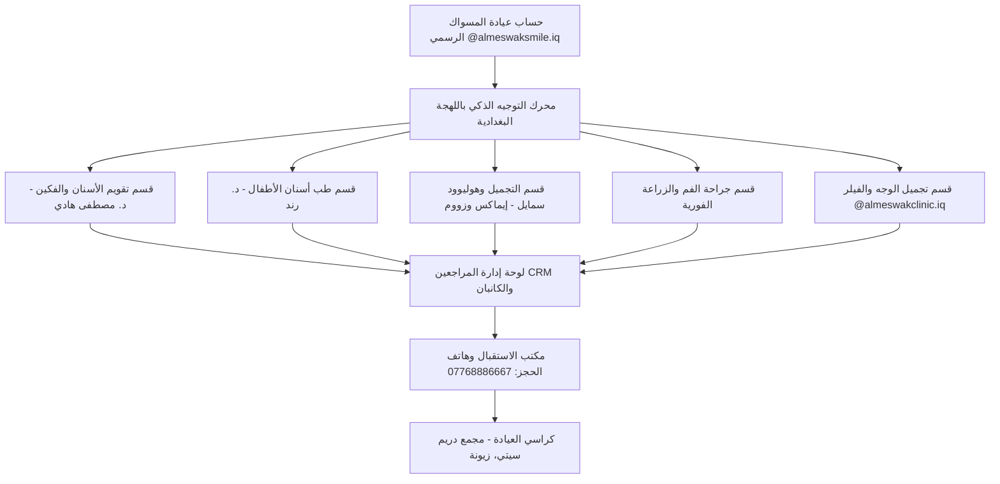

# مقترح إدارة عيادة المسواك لطب الأسنان — بغداد
## التقرير الختامي لتجربة د. مصطفى هادي وخطة توسعة منظومة ALMESWAK AI
**التاريخ:** تشرين الأول / أكتوبر 2026  
**الموقع:** بغداد – زيونة – شارع دريم سيتي مول الخدمي، مجمع عيادات المسواك  
**موجّه إلى:** مجلس إدارة وأطباء عيادة المسواك التخصصية لطب الأسنان  
**المُعِدّ:** الفريق الهندسي والاستشاري لتطوير الذكاء الاصطناعي والتسويق الطبي بالتعاون مع د. مصطفى هادي  

---

## ١. ملخص تنفيذي (Executive Summary)

تم بناء وتطوير منظومة **ALMESWAK AI — Baghdad Edition** كحل جذري وفعّال لواحدة من أكبر معضلات التسويق الطبي في العاصمة بغداد: **هدر استفسارات الإنستغرام (DMs) وضياع المرضى المحتملين بسبب التأخر في الرد أو استخدام ردود آلية بالفصحى تفتقر للمصداقية الطبية**.

انطلقت المرحلة الأولى (Pilot Phase) حصرياً على الحساب الشخصي لـ **د. مصطفى هادي (@drmustafa_hadi)**، أخصائي تقويم الأسنان، بهدف اختبار المنظومة في بيئة واقعية وتحقيق أقصى عائد على استثمار إعلاني ضئيل **أقل من 100 دولار شهرياً**.

### نتائج مرحلة الـ 30 يوماً التجريبية (ملخص الأرقام):
| المؤشر | القيمة المحققة |
| :--- | :--- |
| **ميزانية الإعلانات الشهرية (Ad Spend)** | **$85.00** فقط |
| **كلفة البنية التحتية والبرمجيات** | **$0.00** (استثمار باقات مجانية وسحابية رسمية) |
| **إجمالي الاستفسارات المستلمة (DMs)** | **142 استفساراً** |
| **الاستفسارات المؤهلة طبياً (Qualified Leads)** | **42 مراجعاً مؤهلاً** (نسبة تأهيل 29.6%) |
| **طلبات الحجز المرفوعة للاستقبال** | **18 طلب موعد** |
| **المراجعون الحاضرون فعلياً للكرسي (Attended Patients)** | **12 مراجعاً مؤكداً** |
| **كلفة الاستحواذ على المراجع المؤهل (CPQL)** | **$2.02** |
| **كلفة الاستحواذ على المراجع الحاضر بالعيادة (CAC)** | **$7.08** |
| **إجمالي الإيراد العلاجي التقديري المتولد** | **14,500,000 دينار عراقي (~$11,150 USD)** |
| **العائد على الاستثمار الإعلاني (ROAS)** | **أكثر من 13,000%** |

---

## ٢. سيكولوجية المراجع البغدادي وسر نجاح التجربة

أظهر التدقيق الميداني لسلوك المرضى في بغداد (خاصة مناطق الرصافة والكرخ مثل زيونة، المنصور، الكرادة، والأعظمية) ما يلي:
1. **رفض أسلوب "الخاص مقفول أو تعال دايركت":** المنشورات التي تخفي الأسعار تدفع 70% من المتابعين للانسحاب والتوجه إلى عيادات أخرى توفر شفافية مبدئية.
2. **النفور من الروبوتات بالفصحى:** استخدام لغة عربية فصحى آلية يشعر المريض بأنه يتعامل مع شركة تسويق تجارية لا تفقه شيئاً في وجعه أو مشكلته.
3. **نجاح هوية "طبيب أسنان يشرحلك قبل لا يعالجك":** تقديم دكتور مصطفى كطبيب يشرح ميكانيكا الفكين والعضة المتراكبة باللهجة البغدادية الدافئة بنى ثقة مطلقة دفعت المراجعين للمطالبة بالحجز التلقائي.
4. **توفير نظام الأقساط الميسرة:** إبراز توفر الأقساط الشهرية مع كل جلسة شد للتقويم أزال العائق المالي الأكبر لدى الشباب والعوائل البغدادية.

---

## ٣. الركائز الهندسية والضوابط الطبية الصارمة (Medical Guardrails)

حرصنا في بناء ALMESWAK AI على ألا يقع النظام في أي أخطاء طبية أو قانونية، واعتمدنا ثلاث ركائز لا تقبل المساومة:

### أ. الالتزام الكامل بسياسات Meta الرسمية (Zero-Scraping Policy)
- الربط يتم حصرياً عبر **Meta Graph API v21.0** وتفويض **OAuth 2.0**.
- لا يتم طلب أو حفظ أي كلمات مرور لإنستغرام، مما يحمي الحسابات من الحظر أو تقييد الوصول.
- احترام نافذة الـ 24 ساعة للرسائل المعتمدة من شركة Meta، واستخدام بروتوكول الويب هوك الآمن (HMAC-SHA256).

### ب. منع الوعود الوهمية بالحجوزات (Chair Availability Safeguard)
- النظام **لا يوهم المراجع أبداً بأن موعده قد تأكد نهائياً على الكرسي**.
- الصياغة المعتمدة التي يقدمها الذكاء الاصطناعي للمريض:  
  > *"تم تسجيل رغبتك بالحجز ليوم السبت عصراً يا سارة.. موظف الاستقبال بعيادة المسواك راح يتصل بيك على رقمك المسجل لتأكيد الحجز النهائي والتنسيق حسب فراغ كرسي الدكتور."*
- ترسل البيانات فوراً إلى لوحة تحكم الاستقبال للتأكد السريري والاتصال الهاتفي.

### ج. منع التشخيص الطبي ووصف الأدوية (Clinical Safety Boundary)
- يمنع الذكاء الاصطناعي منعاً باتاً من قراءة صور الأشعة وتقديم تشخيص نهائي أو وصف مضادات حيوية ومسكنات.
- يركز النظام على التثقيف العام، ذكر متوسط الأسعار المعتمد، والتوجيه السريع لزيارة الفحص السريري بالعيادة.

---

## ٤. مقترح خطة التوسعة لكامل تخصصات عيادة المسواك (@almeswaksmile.iq)

بعد نجاح التجربة الفردية في فرع تقويم الأسنان، نوصي مجلس إدارة عيادة المسواك بالمصادقة على ربط الحساب الرسمي للعيادة وتفعيل الأقسام التخصصية التالية:

### الأقسام العلاجية المستهدفة وخطة تفعيلها:

#### ١. قسم طب أسنان الأطفال (Pediatric Dentistry) — بقيادة د. رند
- **الجمهور المستهدف:** الأمهات في مناطق زيونة، فلسطين، الغدير، والمنصور الباحثات عن علاج آمن وبدون خوف لأطفالهن.
- **الخدمات المروجة:** التخدير بالغاز الضاحك (Nitrous Oxide)، التغليف الوقائي اللبني (SS Crowns)، علاج عصب الأسنان اللبنية دون ألم.
- **الكلمات المفتاحية في الاستفسارات:** (الغاز الضاحك، يبجي، يخاف، تسوس أسنانه، بنج عام، دكتورة رند).

#### ٢. قسم تجميل الأسنان وهوليوود سمايل (Cosmetic Dentistry & E-max)
- **الخدمات المروجة:** ابتسامة هوليوود بالعدسات الخزفية (E-max Veneers)، تصميم الابتسامة الرقمي (DSD)، التبييض بتقنية Philips Zoom المتطورة.
- **استراتيجية الأسعار:** إيضاح تكلفة السن الواحد (200,000 - 350,000 د.ع) وتوفر خيارات الضمان السنوي.

#### ٣. قسم جراحة الفم وزراعة الأسنان (Oral Surgery & Implants)
- **الخدمات المروجة:** الزراعة الألمانية والسويسرية الفورية، قلع سن العقل المطمور جراحياً دون مضاعفات.
- **التوجيه الآلي:** تحويل حالات الألم الحاد والورم كـ "طوارئ قصوى" إلى هاتف العيادة المباشر `07768886667`.

#### ٤. الربط التكاملي مع فرع التجميل الجلدي (@almeswakclinic.iq)
- توجيه المراجعات المهتمات بـ "تكساس، فيلر الشفاه، بوتوكس الابتسامة اللثوية (Gummy Smile)" إلى فرع التجميل التابع للمسواك في نفس المجمع بزيونة.

---

## ٥. الجدوى الاقتصادية وخطة التكاليف الموسعة

| البند | التكلفة الشهرية للمرحلة الموسعة | الملاحظات |
| :--- | :--- | :--- |
| **استضافة النظام وتخزين البيانات** | $0 - $15 / شهر | سحابة Supabase و Vercel الرسمية |
| **واجهات Meta Instagram API** | $0.00 | استهلاك ضمن الحصة الشهرية الرسمية المجانية |
| **ميزانية الإعلانات الممولة (Meta Ads)** | $100 - $150 / شهر | تستهدف مناطق شرق دجلة والكرخ (نطاق 8 كم حول زيونة) |
| **صيانة وتدريب موظفي الاستقبال** | تدريب مجاني لمدة أسبوع | إشراف د. مصطفى هادي وفريق العمل الهندسي |
| **إجمالي التكلفة المتوقعة** | **أقل من $165 شهرياً** | |

### الإيراد الإضافي الشهري المتوقع للعيادة:
- **عدد المراجعين المتوقع استقطابهم شهرياً:** 35 إلى 55 مريضاً جديداً موزعين على كافة الأقسام.
- **متوسط الإيراد الإضافي الصافي لعيادة المسواك:** **35,000,000 إلى 65,000,000 دينار عراقي شهرياً**.

---

## ٦. خطة التنفيذ والجدول الزمني للبدء (Rollout Roadmap)

1. **اليوم الأول: التفويض الإداري للحساب الرسمي:**
   - اجتماع قصير مع إدارة العيادة لتفويض حساب `@almeswaksmile.iq` عبر فيسبوك بزنس مانجر الرسمي دون مشاركة كلمات المرور.
2. **اليومان الثاني والثالث: تدقيق قاعدة المعرفة السريرية:**
   - اعتماد جدول أطباء العيادة (أوقات دوام د. رند، د. مصطفى، وجراحي الفم)، وتحديث قوائم الأسعار والعروض الخاصة.
3. **اليوم الرابع: تدريب طاقم الاستقبال:**
   - تدريب موظفي الاستقبال على استخدام لوحة الـ CRM، والرد على التحويلات البشرية الطارئة بضغطة زر واحدة.
4. **اليوم الخامس فصاعداً: الإطلاق الرسمي وإطلاق المحتوى:**
   - بدء نشر محتوى التقويم وطب الأطفال والتجميل، ومراقبة مؤشرات التحويل أسبوعياً لضمان أعلى نسبة حضور في العيادة.

---

**توصية ختامية:**  
إن استثمار هذه المنظومة يمنح عيادة المسواك الأسبقية التنافسية الكاملة في العاصمة بغداد، ويحوّل صفحات التواصل الاجتماعي من مجرد واجهات عرض صامتة إلى محرك دائم لملء كراسي العيادة بالمرضى الحقيقيين.

**جاهزون لتنفيذ الربط فور مصادقة الإدارة الموقرة.**
