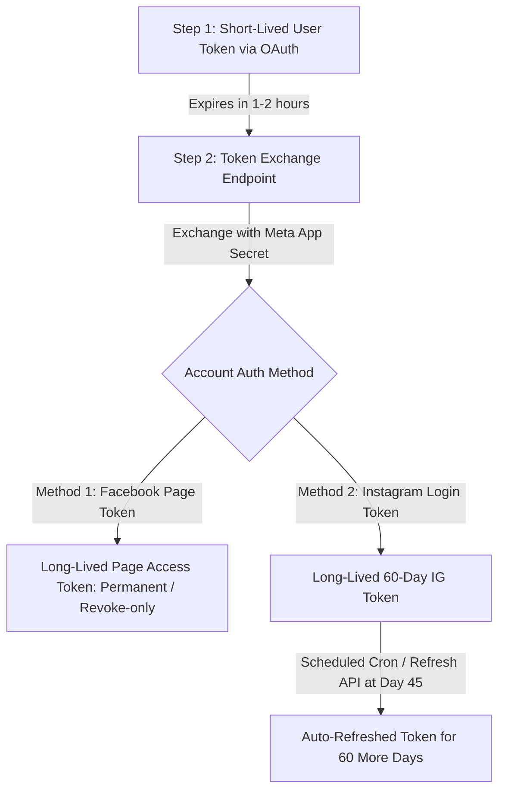

# MUSTAFAH-AI — META INSTAGRAM API COMPATIBILITY AUDIT
## Technical Specification & Integration Runbook for `@drmustafa_hadi`

---

## 1. Executive Summary

Meta provides two fundamentally distinct APIs for Instagram Messaging:
1. **Instagram Graph API (via Facebook Login for Business)**
2. **Instagram Messaging API (via Instagram Login)**

> [!WARNING]
> **Token Incompatibility Notice:**
> A Facebook Page Access Token and an Instagram Login User Access Token are **NOT interchangeable**.
> Using a Facebook Page token on `graph.instagram.com` or an Instagram Login token on `graph.facebook.com` will result in an immediate `(#190) OAuthException` or `(#100) Invalid parameter`.
> 
> MustafaH-AI has been engineered to dynamically detect and support **both** authentication pathways while guaranteeing strict isolation from `@almeswaksmile.iq`.

---

## 2. Comprehensive Comparison Matrix

| Attribute | Method 1: Facebook Login for Business (Recommended) | Method 2: Instagram Login for Creators |
| :--- | :--- | :--- |
| **Meta Product** | **Instagram Graph API** | **Instagram Messaging API** |
| **Login URL** | `https://www.facebook.com/v21.0/dialog/oauth` | `https://api.instagram.com/oauth/authorize` |
| **API Hostname** | `https://graph.facebook.com/v21.0/me/messages` | `https://graph.instagram.com/v21.0/me/messages` |
| **Token Prefix** | Standard Meta token (typically `EAAB...` or `EAAQ...`) | Instagram User token (starts with `IGAA...`) |
| **Token Type** | **Facebook Page Access Token** | **Instagram User Access Token** |
| **Facebook Page Required?** | **YES** (Must be connected to the IG account) | **NO** (Connects directly to Instagram) |
| **Account Type Required** | Professional (Creator or Business) | Professional (Creator or Business) |
| **Required Permissions** | `instagram_basic` `instagram_manage_messages` `pages_manage_metadata` `pages_show_list` | `instagram_business_basic` `instagram_business_manage_messages` |
| **Token Lifetime** | Long-lived Page token (Never expires unless revoked) | 60 days (Must be refreshed before expiry) |
| **Refresh Endpoint** | `oauth/access_token?grant_type=fb_exchange_token` | `refresh_access_token?grant_type=ig_refresh_token` |
| **App Review Requirements** | Business Verification + App Review for Live DMs | App Review for Live DMs |

---

## 3. Account Prerequisites for `@drmustafa_hadi`

To enable live automated Iraqi Arabic messaging, Dr. Mustafa Hadi's personal account (`@drmustafa_hadi`) must satisfy the following configuration prerequisites:

### A. Switch to a Professional Account
1. Open the Instagram app on iOS/Android.
2. Go to **Profile** > **Settings and privacy** > **Account type and tools**.
3. Select **Switch to Professional Account** and choose **Dentist** or **Medical & Health**.
4. Select account category: **Creator** or **Business**.

### B. Toggle "Allow Access to Messages" (Mandatory)
Meta blocks third-party bot dispatch by default unless explicitly toggled in the Instagram mobile app:
1. Go to **Settings and privacy** > **Messages and story replies**.
2. Tap **Message controls** > **Connected tools**.
3. Set **"Allow access to messages"** to **ON**.
*(If this setting is OFF, incoming DMs will not trigger webhook events and outbound API calls will return Error Code 10).*

### C. Connect Facebook Page (For Method 1: Facebook Login)
1. In Instagram App, go to **Settings** > **Creator tools and controls** > **Connect a Facebook Page**.
2. Connect Dr. Mustafa Hadi's verified Facebook professional page.
3. Grant Page admin access to the Meta Developer App.

---

## 4. Webhook Subscription & Verification Protocol

### Webhook Handshake Endpoint (`GET /api/webhooks/instagram`)
* **Meta Query Parameters:**
  - `hub.mode = "subscribe"`
  - `hub.verify_token`: Must match `process.env.META_VERIFY_TOKEN`.
  - `hub.challenge`: Plain-text challenge integer string returned with HTTP 200.

### Webhook Ingestion Endpoint (`POST /api/webhooks/instagram`)
* **Signature Header:** `X-Hub-Signature-256` matching `sha256=<HMAC-SHA256(rawBody, META_APP_SECRET)>`.
* **Subscribed Fields in Meta App Dashboard:**
  - `messages` (Mandatory: incoming text, story replies, quick replies)
  - `messaging_postbacks` (CTA button clicks)
  - `message_reactions` (Heart / emoji taps)

---

## 5. Token Lifecycle & Auto-Refresh Strategy

### Auto-Detection in MustafaH-AI Dispatcher
[`InstagramGraphApiDispatcher`](file:///c:/Users/gigia/OneDrive/Desktop/ai/src/lib/instagram/graphApi.ts) automatically analyzes the token prefix:
* If token starts with `IGAA...`: Automatically routes to `https://graph.instagram.com/v21.0/me/messages`.
* Otherwise: Automatically routes to `https://graph.facebook.com/v21.0/me/messages`.
This guarantees zero disruption regardless of which Meta product is provisioned.

