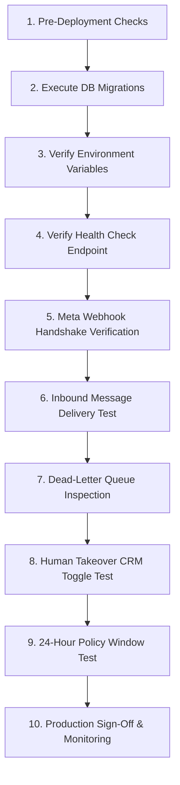

# MUSTAFAH-AI — BAGHDAD EDITION
# Production Deployment & Meta Configuration Runbook
**Document Version:** 4.0.0 (Phase 4: Deployment Preparation & Database Validation)  
**Author:** AI Engineering & Meta Infrastructure Team  
**Scope:** Pilot Account `@drmustafa_hadi` (Personal Dental Brand)  
**Account Isolation:** `@almeswaksmile.iq` strictly locked in Demo Mode  

---

## 1. Meta for Developers & App Configuration

### 1.1 App Creation & Type
1. Log in to the [Meta for Developers Console](https://developers.facebook.com/).
2. Click **Create App** and select **Business** as the App Type. (The Business app type supports Instagram Graph API, Facebook Pages, and webhooks).
3. Enter App Details:
   - **App Display Name:** `MustafaH-AI Assistant`
   - **App Contact Email:** `mustafa.hadi@almeswak.iq` (or Dr. Mustafa's verified email)
   - **Business Account:** Connect to Dr. Mustafa Hadi's Meta Business Account.

### 1.2 Products to Add
Add the following products to the app:
1. **Instagram Graph API**: Provides the messaging engine, user profile resolution, and media attachments.
2. **Webhooks**: Delivers real-time inbound events (`messages`, `messaging_postbacks`, `message_reactions`).

---

## 2. Primary Authentication Method Selection

### 2.1 Chosen Architecture: Instagram Graph API via Facebook Login for Business
To ensure production stability and eliminate ambiguous token routing, **MustafaH-AI explicitly standardizes on ONE primary authentication path**:

> **Selected Method:** **Instagram Graph API via Facebook Login for Business (Page Access Token)**.

#### Why this method was selected over Instagram Login for Tech Providers:
1. **Token Longevity & Operational Reliability:**  
   - Instagram User Access Tokens (Tech Provider route, starting with `IGAA...`) expire every 60 days and require automated refresh rotations that can fail during hosting redeployments.
   - Long-lived Facebook **Page Access Tokens** linked to an Instagram Professional account have **no expiry date** (they remain valid permanently unless Dr. Mustafa changes his password or unlinks the Page), completely preventing production token expiration outages.
2. **Direct Webhook Page Subscription:**  
   - Meta routes Instagram messages reliably through the Page's webhook subscription pipeline (`page` webhook topics), which is fully hardened and tested.
3. **Medical Practice Governance:**  
   - Allows Dr. Mustafa's Facebook Page ("د. مصطفى هادي") to be linked directly to his professional Instagram account (`@drmustafa_hadi`), establishing verified business legitimacy in Iraq.

---

### 2.2 Step-by-Step Account Linking: Page to Instagram Professional Account
1. Open the Instagram mobile app on Dr. Mustafa's phone:
   - Navigate to **Settings and Privacy** -> **Account Type and Tools** -> Switch to **Professional Account** (Category: *Dentist* or *Orthodontist*).
2. Open [Meta Business Suite](https://business.facebook.com/):
   - Go to **Settings** -> **Business Assets** -> **Instagram Accounts**.
   - Click **Add Instagram Account** and log in with `@drmustafa_hadi`.
   - Connect the account to Dr. Mustafa's Facebook Page (`د. مصطفى هادي`).
   - Under **Connected Accounts**, confirm that **Allow access to Instagram messages in Inbox** is toggled **ON**.

---

### 2.3 Token Generation Runbook for `@drmustafa_hadi`

Follow this exact sequence to generate the permanent production Page Access Token:

1. **Open Graph API Explorer:**  
   Go to [Meta Graph API Explorer](https://developers.facebook.com/tools/explorer/).
   - Select your app: `MustafaH-AI Assistant`.
2. **Request User Token with Scopes:**  
   Under **User or Page**, select **Get User Access Token**. Check the following 4 required permissions:
   - `instagram_basic`
   - `instagram_manage_messages`
   - `pages_manage_metadata`
   - `pages_show_list`
   Click **Generate Access Token** and approve the Facebook permissions dialog.
3. **Exchange for Long-Lived User Access Token:**  
   Send a GET request to exchange the short-lived user token for a 60-day token:
   ```bash
   curl -X GET "https://graph.facebook.com/v21.0/oauth/access_token?\
     grant_type=fb_exchange_token&\
     client_id=YOUR_META_APP_ID&\
     client_secret=YOUR_META_APP_SECRET&\
     fb_exchange_token=SHORT_LIVED_USER_TOKEN"
   ```
4. **Obtain the Permanent Page Access Token:**  
   Using the long-lived user token, query the accounts endpoint:
   ```bash
   curl -X GET "https://graph.facebook.com/v21.0/me/accounts?\
     access_token=LONG_LIVED_USER_TOKEN"
   ```
   Locate the entry for Dr. Mustafa's Facebook Page. Copy the `access_token` from that specific page object.  
   *Because this token was derived from a long-lived user token, the Page Access Token does not expire.*
5. **Verify Token via Access Token Debugger:**  
   Visit [Meta Access Token Debugger](https://developers.facebook.com/tools/debug/accesstoken/).  
   Paste the token and verify:
   - **Type:** Page
   - **App ID:** Matches `MustafaH-AI Assistant`
   - **Expires:** Never
   - **Scopes:** `instagram_basic`, `instagram_manage_messages`, `pages_manage_metadata`, `pages_show_list`
6. Store this token as `DR_MUSTAFA_ACCESS_TOKEN` in production environment variables.

---

### 2.4 Webhook Subscription & Verification Setup
1. In Meta Developer Console, go to **Webhooks** -> Select **Instagram** from the dropdown.
2. Click **Subscribe to this object**:
   - **Callback URL:** `https://mustafah-ai.almeswak.iq/api/webhooks/instagram`
   - **Verify Token:** Value of `META_VERIFY_TOKEN` (from `.env.production`)
3. Click **Verify and Save**. Meta will send a GET challenge request; MustafaH-AI will immediately validate the token and return the challenge with 200 OK.
4. Under **Subscribed Fields**, subscribe to:
   - `messages` (Mandatory: incoming text, voice, media DMs)
   - `messaging_postbacks` (Quick replies and CTA button taps)
   - `message_reactions` (Patient emoji reactions)

---

### 2.5 Development Testing & App Review Requirements
- **Development Mode Testing:**
  - In Meta Developer Console, go to **App Roles** -> **Roles**.
  - Add Dr. Mustafa's personal Facebook/Instagram account as **Developer** or **Tester**.
  - Add test patient accounts as **Testers** to test incoming and outbound DMs before public App Review.
- **App Review Requirements for Production Live Mode:**
  - **Business Verification:** Provide clinic registration certificate / Iraqi dental syndicate license.
  - **Permissions Requested:** `instagram_manage_messages` and `pages_manage_metadata`.
  - **Review Submission Notes:**
    - Explain that MustafaH-AI is a specialized Iraqi Arabic clinical dental intake assistant.
    - Emphasize the strict safety policies: **Zero Orthodontic Pricing Disclosure** without in-person clinical examination, emergency escalation hotline `07768886667`, and human takeover protocol.
    - Provide a screen recording showing the Iraqi Arabic conversation flow and human handoff.

---

## 3. Database Architecture & Supabase Validation

### 3.1 Migration Execution Order
Execute migrations strictly in chronological sequence using the direct connection (`DIRECT_URL` on port 5432):
1. `supabase/migrations/20261030000000_almeswak_schema.sql`  
   - Creates UUID extension, core accounts, leads, appointments, conversations, messages, content items, and ad campaigns.
   - Seeds `drmustafa_hadi` (connected) and `almeswaksmile_iq` (demo_mode).
2. `supabase/migrations/20261031000000_phase3_reliability.sql`  
   - Creates `processed_webhook_messages` (deduplication).
   - Creates `human_takeovers` (partial unique index `WHERE is_active = TRUE`).
   - Creates `escalation_events` (audit log).
   - Creates `webhook_jobs` (async queue).
3. `supabase/migrations/20261031010000_phase4_rls_and_pooling.sql`  
   - Enables Row Level Security (RLS) on all 12 tables.
   - Enforces service-role bypass for backend webhooks & background workers.
   - Enforces strict tenant isolation for `@drmustafa_hadi` and protects `@almeswaksmile_iq`.

### 3.2 Connection Pooling Configuration
- **Transaction Mode Pooler (Port 6543):**
  - Use `DATABASE_URL` pointing to `...pooler.supabase.com:6543/postgres?pgbouncer=true`.
  - Recommended for all Next.js serverless functions and API routes.
  - Re-uses database connections across stateless serverless invocations, preventing connection exhaustion.
- **Direct Session Connection (Port 5432):**
  - Use `DIRECT_URL` pointing to port 5432.
  - Reserved exclusively for running schema migrations, Prisma/Drizzle DDL, or long-running tasks.

---

## 4. Fail-Safe Closed Architecture Specification

### What happens when the database is unreachable?
When `FAIL_SAFE_CLOSED=true` (default in production):
1. **The application refuses to send unverified automated messages.**
   - Without confirmed persistent state, the system cannot verify if the message was already answered, if a human doctor has taken over, or if the conversation is outside the 24-hour window.
2. **Webhook Acknowledgment:**
   - The webhook returns HTTP `200 OK` with status `FAIL_SAFE_DB_UNAVAILABLE_CLOSED` to Meta.
   - *Why 200 OK?* Returning 500 would trigger Meta's exponential retry flood, amplifying pressure on an already degraded database and risking Meta webhook suspension.
3. **Escalation & Recovery:**
   - The event is logged to stderr with critical severity.
   - Once the database reconnects, the message can be reviewed in CRM or reprocessed via the background queue.

---

## 5. Background Job Worker & Concurrency Control

### 5.1 Concurrency & Atomic Claiming
- Workers call `PersistentStore.dequeueJob(workerId)`.
- The job status atomically transitions from `pending` -> `processing` with `locked_at = now` and `locked_by = workerId`.
- No two workers can process the same job concurrently.

### 5.2 Exponential Backoff & Retries
- Delay formula: $\text{delay} = \text{baseBackoffMs} \times 2^{(\text{attempts} - 1)}$.
- Defaults: Attempt 1 = 1s, Attempt 2 = 2s, Attempt 3 = 4s.
- If `attempts >= maxAttempts` (3), the job transitions to `dead_letter` and triggers a critical escalation event.

### 5.3 Mandatory 24-Hour Policy Re-Validation
- When a delayed job is retried by the worker, the worker calculates:
  $\text{elapsed} = \text{now} - \text{incomingTimestamp}$.
- If $\text{elapsed} > 24\text{ hours}$:
  - Automated dispatch is **strictly cancelled**.
  - Job status is set to `OUTSIDE_24H_WINDOW_CANCELLED`.
  - Human takeover is activated.
  - An `outside_24h_window` escalation event is durably recorded.

### 5.4 Human Takeover Re-Check
- If human staff took over the conversation while the job was in queue, the worker cancels the automated reply with status `TAKEOVER_SUPPRESSED` and completes the job without sending.

---

## 6. Step-by-Step Deployment Runbook (10 Steps)



### Step 1: Pre-Deployment Checks
- Verify local git branch is clean and all 151+ tests pass.
- Verify production build succeeds (`npm run build`).
- Confirm `@almeswaksmile.iq` is marked as Demo Mode in configuration.

### Step 2: Database Migration Execution and Validation
- Connect to Supabase via `DIRECT_URL` (Port 5432).
- Apply migrations 1, 2, and 3 in sequence.
- Query tables and verify Row Level Security is `ENABLED` on all 12 tables:
  ```sql
  SELECT tablename, rowsecurity FROM pg_tables WHERE schemaname = 'public';
  ```

### Step 3: Environment Variable Verification
- Check all variables in `.env.production` are populated.
- Confirm `SUPABASE_SERVICE_ROLE_KEY` is set and never exposed to client (`NEXT_PUBLIC_`).
- Confirm `FAIL_SAFE_CLOSED=true`.

### Step 4: Health Check Endpoint Verification
- Make a GET request to `/api/health`:
  ```bash
  curl -i https://mustafah-ai.almeswak.iq/api/health
  ```
- Verify HTTP 200, `database.connected: true`, and `meta.clinicAccountLockedInDemo: true`.

### Step 5: Meta Webhook Verification (Challenge-Response Handshake)
- Send a test GET request replicating Meta's webhook verification:
  ```bash
  curl -i "https://mustafah-ai.almeswak.iq/api/webhooks/instagram?\
  hub.mode=subscribe&\
  hub.challenge=test_challenge_12345&\
  hub.verify_token=YOUR_META_VERIFY_TOKEN"
  ```
- Expected output: HTTP 200 with raw body `test_challenge_12345`.

### Step 6: Inbound Message Delivery Test (Dry-Run / Safe Mode)
- Dispatch a signed mock payload to `/api/webhooks/instagram` targeting Dr. Mustafa's account with query "وين موقع العيادة؟".
- Verify HMAC-SHA256 signature validates.
- Verify status returns `EVENT_RECEIVED` and `dbFailSafeClosed: 0`.

### Step 7: Dead-Letter Queue Inspection
- Query `webhook_jobs` table:
  ```sql
  SELECT id, message_id, status, attempts, last_error FROM webhook_jobs WHERE status = 'dead_letter';
  ```
- Confirm queue is clean (0 records initially).

### Step 8: Human Takeover Toggle Test from CRM
- Set takeover for test user `test_patient_ig_101`.
- Verify record inserted into `human_takeovers` with `is_active = true`.
- Send another inbound DM from `test_patient_ig_101` and verify status is `HUMAN_TAKEOVER_ACTIVE_NO_AI_REPLY`.
- Release takeover and confirm normal operation resumes.

### Step 9: 24-Hour Policy Enforcement Verification
- Send a mock message with timestamp older than 25 hours.
- Verify message is blocked from automated response and flagged `OUTSIDE_24H_WINDOW_ESCALATED`.

### Step 10: Production Sign-Off & Monitoring
- Check application telemetry logs for any unexpected unhandled exceptions.
- Pilot system is now live for Dr. Mustafa Hadi (`@drmustafa_hadi`).

---

## 7. Rollback Runbook

If any critical failure occurs post-deployment:
1. **Immediate Outbound Suppress:**  
   Set `DR_MUSTAFA_ACCESS_TOKEN=""` or set `FAIL_SAFE_CLOSED=true` in Vercel/hosting environment variables. This immediately blocks all automated outbound messaging while keeping webhooks receiving.
2. **Meta Webhook Pause:**  
   In Meta Developer Console -> Webhooks -> Instagram, click **Edit Subscription** and temporarily unsubscribe the `messages` field. Inbound messages will accumulate safely in Instagram Direct Inbox for manual staff handling.
3. **Revert Git Deployment:**  
   Deploy the previous verified commit `b4c1a76`.
4. **Database Rollback:**  
   Migrations are strictly non-destructive. If needed, disable RLS on specific tables:
   ```sql
   ALTER TABLE leads DISABLE ROW LEVEL SECURITY;
   ```

---

## 8. Account Isolation Final Confirmation

| Check | Specification | Status |
|---|---|---|
| **Pilot Account** | `@drmustafa_hadi` | **LIVE CANDIDATE** (Subject to authorized credentials) |
| **Clinic Account** | `@almeswaksmile.iq` | **STRICTLY LOCKED IN DEMO MODE** |
| **Webhook Layer** | Inbound events targeting `@almeswaksmile.iq` rejected | **ENFORCED** (`CLINIC_ACCOUNT_LOCKED`) |
| **Dispatcher Layer** | Outbound calls for clinic account rejected | **ENFORCED** (`ACCOUNT_ISOLATION_PROHIBITION`) |
| **Worker Layer** | Queue jobs for clinic account aborted | **ENFORCED** (`ACCOUNT_ISOLATION_BLOCKED`) |
| **Database Layer** | RLS prevents modifying clinic account status | **ENFORCED** (`Clinic workspace isolation guard`) |
| **Dashboard UI** | Header & workspace selector displays Demo Mode badge | **ENFORCED** (Badge visible in UI) |

