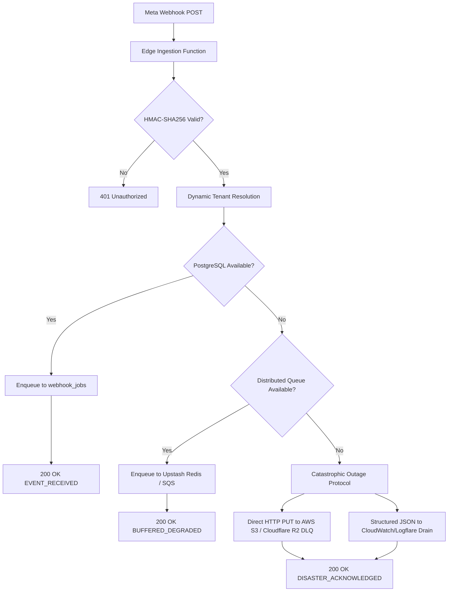

# MustafaH-AI — Multi-Clinic SaaS Architectural Specification & Migration Plan

**Document Version:** 2.0.0 (Comprehensive Multi-Tenant SaaS Blueprint)  
**Status:** DRAFT SPECIFICATION & AUDIT (Pending User Approval — Zero Database/Code Changes Executed)  
**Classification:** Proprietary Architectural Blueprint  
**Founding Pilot Tenant:** Dr. Mustafa Hadi (`@drmustafa_hadi` — Personal Dental Brand)  
**Isolated Demo Tenant:** Almeswak Dental Clinic (`@almeswaksmile.iq` — Strictly Locked in Demo Mode)  

---

## Executive Architectural Summary

MustafaH-AI is evolving from a single-clinic Instagram assistant into an **Enterprise Multi-Clinic Dental SaaS Platform**. The platform will host multiple independent dental practices across Baghdad and Iraq on a unified, high-performance infrastructure while guaranteeing **cryptographic, operational, and relational tenant isolation**.

### Uncompromising Platform Principles
1. **Pilot Continuity:** Dr. Mustafa Hadi (`@drmustafa_hadi`) is preserved as the founding tenant (`org_drmustafa_hadi`). All 213 passing automated tests and historical clinic records will transition seamlessly with zero downtime.
2. **Clinic Workspace Protection:** Almeswak Dental Clinic (`@almeswaksmile.iq`) remains quarantined in Demo Mode without live credentials or outbound message capabilities until clinic management authorizes activation.
3. **Immutable Orthodontic Pricing Prohibition:** The prohibition against disclosing orthodontic prices, ranges, down payments, or installment plans via automated channels is an **immutable platform-level policy**. No clinic owner or tenant setting can disable or override this restriction.
4. **Zero-Trust Multi-Tenancy:** No clinic may ever view, mutate, or inherit another clinic's branding, location, phone number, clinical FAQs, leads, conversations, or access tokens.
5. **Stateless Serverless Reliability:** No ephemeral local filesystem buffer may be relied upon for production webhook recovery. Ingestion resilience must operate via distributed cloud infrastructure.

---

## 1. Database Ownership & Isolation Matrix for All 12 Existing Tables

Every existing table from Phases 1–4 has been audited. The table below specifies its exact multi-tenant ownership model, foreign key strategy, indexing, and migration path.

| # | Existing Table | Primary Tenant Key | Ownership Type | Foreign Key & Referential Action | Composite Index / Constraints | Data Backfill Strategy |
|---|---|---|---|---|---|---|
| **1** | `instagram_accounts` | `organization_id UUID` | Direct Tenant Asset | `REFERENCES organizations(id) ON DELETE CASCADE` | `UNIQUE(organization_id, handle)`<br>`INDEX(organization_id, status)` | Map `'drmustafa_hadi'` to Dr. Mustafa's org; map `'almeswaksmile_iq'` to Almeswak org. |
| **2** | `leads` | `organization_id UUID` | Direct Tenant Data | `REFERENCES organizations(id) ON DELETE CASCADE` | `INDEX(organization_id, status)`<br>`INDEX(organization_id, phone)` | Backfill `organization_id` matching `account_id` mapping. |
| **3** | `appointments` | `organization_id UUID` | Direct Tenant Data | `REFERENCES organizations(id) ON DELETE CASCADE`<br>`lead_id REFERENCES leads(id) ON DELETE SET NULL` | `INDEX(organization_id, preferred_date)`<br>`INDEX(organization_id, status)` | Backfill `organization_id` matching `account_id` mapping. |
| **4** | `conversations` | `organization_id UUID` | Direct Tenant Data | `REFERENCES organizations(id) ON DELETE CASCADE` | `UNIQUE(organization_id, id)`<br>`INDEX(organization_id, status)` | Backfill `organization_id` matching `account_id` mapping. |
| **5** | `chat_messages` | `organization_id UUID` | Dual: Direct & Parent | `organization_id REFERENCES organizations(id) ON DELETE CASCADE`<br>`conversation_id REFERENCES conversations(id) ON DELETE CASCADE` | `INDEX(organization_id, conversation_id)`<br>`INDEX(conversation_id, timestamp)` | Backfill `organization_id` via join to parent `conversations.organization_id`. |
| **6** | `content_items` | `organization_id UUID` | Direct Tenant Asset | `REFERENCES organizations(id) ON DELETE CASCADE` | `INDEX(organization_id, scheduled_date)`<br>`INDEX(organization_id, status)` | Backfill `organization_id` matching `account_id` mapping. |
| **7** | `ad_campaigns` | `organization_id UUID` | Direct Tenant Asset | `REFERENCES organizations(id) ON DELETE CASCADE` | `INDEX(organization_id, status)` | Backfill `organization_id` matching `account_id` mapping. |
| **8** | `webhook_logs` | `organization_id UUID` (Nullable) | System Audit Log | `REFERENCES organizations(id) ON DELETE SET NULL` | `INDEX(organization_id, created_at)`<br>`INDEX(status, created_at)` | Backfill where `sender_id` or recipient correlates to known pilot account. Nullable for unauthenticated/unmatched pings. |
| **9** | `processed_webhook_messages` | `organization_id UUID` | Direct Reliability Store | `REFERENCES organizations(id) ON DELETE CASCADE` | `PRIMARY KEY (organization_id, message_id)`<br>`INDEX(organization_id, sender_id)` | Transform PK from `(message_id)` to composite `(organization_id, message_id)`. |
| **10** | `human_takeovers` | `organization_id UUID` | Direct Reliability Store | `REFERENCES organizations(id) ON DELETE CASCADE` | `UNIQUE(organization_id, sender_id) WHERE is_active = TRUE`<br>`INDEX(organization_id, sender_id)` | Update partial unique index to include `organization_id`. |
| **11** | `escalation_events` | `organization_id UUID` | Direct Audit Log | `REFERENCES organizations(id) ON DELETE CASCADE` | `INDEX(organization_id, event_type)`<br>`INDEX(organization_id, requires_followup)` | Backfill `organization_id` matching `account_id` mapping. |
| **12** | `webhook_jobs` | `organization_id UUID` | Direct Queue Task | `REFERENCES organizations(id) ON DELETE CASCADE` | `UNIQUE(organization_id, message_id)`<br>`INDEX(organization_id, status, attempts)` | Backfill `organization_id` matching `account_id` mapping. |

---

## 2. Complete Supabase Row Level Security (RLS) Policies

Every table is protected with comprehensive policies covering **SELECT, INSERT, UPDATE, and DELETE**. The policies rely on the caller's verified membership in `organization_members` via `auth.uid()`.

### 2.1 Core Multi-Tenant Supporting Tables DDL

```sql
-- 1. Organizations (Clinics)
CREATE TABLE IF NOT EXISTS public.organizations (
    id UUID PRIMARY KEY DEFAULT gen_random_uuid(),
    slug TEXT NOT NULL UNIQUE,
    name TEXT NOT NULL,
    name_ar TEXT NOT NULL,
    status TEXT NOT NULL DEFAULT 'active' CHECK (status IN ('active', 'suspended', 'trialing', 'demo_mode')),
    tier TEXT NOT NULL DEFAULT 'starter' CHECK (tier IN ('starter', 'professional', 'enterprise')),
    created_at TIMESTAMPTZ NOT NULL DEFAULT NOW(),
    updated_at TIMESTAMPTZ NOT NULL DEFAULT NOW()
);

-- 2. Organization Members (RBAC)
CREATE TABLE IF NOT EXISTS public.organization_members (
    id UUID PRIMARY KEY DEFAULT gen_random_uuid(),
    organization_id UUID NOT NULL REFERENCES public.organizations(id) ON DELETE CASCADE,
    user_id UUID NOT NULL REFERENCES auth.users(id) ON DELETE CASCADE,
    role TEXT NOT NULL CHECK (role IN ('owner', 'admin', 'dentist', 'receptionist', 'staff')),
    is_active BOOLEAN NOT NULL DEFAULT TRUE,
    created_at TIMESTAMPTZ NOT NULL DEFAULT NOW(),
    updated_at TIMESTAMPTZ NOT NULL DEFAULT NOW(),
    UNIQUE(organization_id, user_id)
);
```

---

### 2.2 Hardened SECURITY DEFINER Helper Functions

To eliminate security vulnerabilities, search path spoofing, and privilege escalation, all helper functions are explicitly qualified with `SET search_path = public, pg_temp` and have default `PUBLIC` execution permissions revoked.

```sql
-- Returns active organization IDs for the authenticated caller
CREATE OR REPLACE FUNCTION public.get_auth_org_ids()
RETURNS TABLE (org_id UUID)
LANGUAGE sql
STABLE
SECURITY DEFINER
SET search_path = public, pg_temp
AS $$
    SELECT organization_id
    FROM public.organization_members
    WHERE user_id = auth.uid()
      AND is_active = TRUE;
$$;

-- Checks if authenticated caller has one of the allowed roles in target organization
CREATE OR REPLACE FUNCTION public.auth_has_role(target_org_id UUID, allowed_roles TEXT[])
RETURNS BOOLEAN
LANGUAGE sql
STABLE
SECURITY DEFINER
SET search_path = public, pg_temp
AS $$
    SELECT EXISTS (
        SELECT 1
        FROM public.organization_members
        WHERE user_id = auth.uid()
          AND organization_id = target_org_id
          AND is_active = TRUE
          AND role = ANY(allowed_roles)
    );
$$;

-- Revoke default public execution rights and grant only to authenticated and service_role
REVOKE ALL ON FUNCTION public.get_auth_org_ids() FROM PUBLIC;
GRANT EXECUTE ON FUNCTION public.get_auth_org_ids() TO authenticated, service_role;

REVOKE ALL ON FUNCTION public.auth_has_role(UUID, TEXT[]) FROM PUBLIC;
GRANT EXECUTE ON FUNCTION public.auth_has_role(UUID, TEXT[]) TO authenticated, service_role;
```

---

### 2.3 Complete RLS Policies Across All 12 Tables

```sql
-- =============================================================================
-- TABLE 1: instagram_accounts
-- =============================================================================
ALTER TABLE public.instagram_accounts ENABLE ROW LEVEL SECURITY;

CREATE POLICY "accounts_select_staff" ON public.instagram_accounts
    FOR SELECT TO authenticated
    USING (organization_id IN (SELECT org_id FROM public.get_auth_org_ids()));

CREATE POLICY "accounts_insert_admin" ON public.instagram_accounts
    FOR INSERT TO authenticated
    WITH CHECK (public.auth_has_role(organization_id, ARRAY['owner', 'admin']));

CREATE POLICY "accounts_update_admin" ON public.instagram_accounts
    FOR UPDATE TO authenticated
    USING (public.auth_has_role(organization_id, ARRAY['owner', 'admin']))
    WITH CHECK (public.auth_has_role(organization_id, ARRAY['owner', 'admin']));

CREATE POLICY "accounts_delete_owner" ON public.instagram_accounts
    FOR DELETE TO authenticated
    USING (public.auth_has_role(organization_id, ARRAY['owner']));

CREATE POLICY "accounts_service_role" ON public.instagram_accounts
    FOR ALL TO service_role
    USING (true) WITH CHECK (true);

-- =============================================================================
-- TABLE 2: leads
-- =============================================================================
ALTER TABLE public.leads ENABLE ROW LEVEL SECURITY;

CREATE POLICY "leads_select_staff" ON public.leads
    FOR SELECT TO authenticated
    USING (organization_id IN (SELECT org_id FROM public.get_auth_org_ids()));

CREATE POLICY "leads_insert_staff" ON public.leads
    FOR INSERT TO authenticated
    WITH CHECK (organization_id IN (SELECT org_id FROM public.get_auth_org_ids()));

CREATE POLICY "leads_update_staff" ON public.leads
    FOR UPDATE TO authenticated
    USING (public.auth_has_role(organization_id, ARRAY['owner', 'admin', 'dentist', 'receptionist']))
    WITH CHECK (organization_id IN (SELECT org_id FROM public.get_auth_org_ids()));

CREATE POLICY "leads_delete_admin" ON public.leads
    FOR DELETE TO authenticated
    USING (public.auth_has_role(organization_id, ARRAY['owner', 'admin']));

CREATE POLICY "leads_service_role" ON public.leads
    FOR ALL TO service_role
    USING (true) WITH CHECK (true);

-- =============================================================================
-- TABLE 3: appointments
-- =============================================================================
ALTER TABLE public.appointments ENABLE ROW LEVEL SECURITY;

CREATE POLICY "appointments_select_staff" ON public.appointments
    FOR SELECT TO authenticated
    USING (organization_id IN (SELECT org_id FROM public.get_auth_org_ids()));

CREATE POLICY "appointments_insert_staff" ON public.appointments
    FOR INSERT TO authenticated
    WITH CHECK (public.auth_has_role(organization_id, ARRAY['owner', 'admin', 'dentist', 'receptionist']));

CREATE POLICY "appointments_update_staff" ON public.appointments
    FOR UPDATE TO authenticated
    USING (public.auth_has_role(organization_id, ARRAY['owner', 'admin', 'dentist', 'receptionist']))
    WITH CHECK (organization_id IN (SELECT org_id FROM public.get_auth_org_ids()));

CREATE POLICY "appointments_delete_admin" ON public.appointments
    FOR DELETE TO authenticated
    USING (public.auth_has_role(organization_id, ARRAY['owner', 'admin']));

CREATE POLICY "appointments_service_role" ON public.appointments
    FOR ALL TO service_role
    USING (true) WITH CHECK (true);

-- =============================================================================
-- TABLE 4: conversations
-- =============================================================================
ALTER TABLE public.conversations ENABLE ROW LEVEL SECURITY;

CREATE POLICY "conversations_select_staff" ON public.conversations
    FOR SELECT TO authenticated
    USING (organization_id IN (SELECT org_id FROM public.get_auth_org_ids()));

CREATE POLICY "conversations_insert_staff" ON public.conversations
    FOR INSERT TO authenticated
    WITH CHECK (organization_id IN (SELECT org_id FROM public.get_auth_org_ids()));

CREATE POLICY "conversations_update_staff" ON public.conversations
    FOR UPDATE TO authenticated
    USING (public.auth_has_role(organization_id, ARRAY['owner', 'admin', 'dentist', 'receptionist']))
    WITH CHECK (organization_id IN (SELECT org_id FROM public.get_auth_org_ids()));

CREATE POLICY "conversations_delete_admin" ON public.conversations
    FOR DELETE TO authenticated
    USING (public.auth_has_role(organization_id, ARRAY['owner', 'admin']));

CREATE POLICY "conversations_service_role" ON public.conversations
    FOR ALL TO service_role
    USING (true) WITH CHECK (true);

-- =============================================================================
-- TABLE 5: chat_messages
-- =============================================================================
ALTER TABLE public.chat_messages ENABLE ROW LEVEL SECURITY;

CREATE POLICY "messages_select_staff" ON public.chat_messages
    FOR SELECT TO authenticated
    USING (organization_id IN (SELECT org_id FROM public.get_auth_org_ids()));

CREATE POLICY "messages_insert_staff" ON public.chat_messages
    FOR INSERT TO authenticated
    WITH CHECK (organization_id IN (SELECT org_id FROM public.get_auth_org_ids()));

CREATE POLICY "messages_update_staff" ON public.chat_messages
    FOR UPDATE TO authenticated
    USING (public.auth_has_role(organization_id, ARRAY['owner', 'admin', 'dentist', 'receptionist']))
    WITH CHECK (organization_id IN (SELECT org_id FROM public.get_auth_org_ids()));

CREATE POLICY "messages_delete_admin" ON public.chat_messages
    FOR DELETE TO authenticated
    USING (public.auth_has_role(organization_id, ARRAY['owner', 'admin']));

CREATE POLICY "messages_service_role" ON public.chat_messages
    FOR ALL TO service_role
    USING (true) WITH CHECK (true);

-- =============================================================================
-- TABLE 6: content_items
-- =============================================================================
ALTER TABLE public.content_items ENABLE ROW LEVEL SECURITY;

CREATE POLICY "content_select_staff" ON public.content_items
    FOR SELECT TO authenticated
    USING (organization_id IN (SELECT org_id FROM public.get_auth_org_ids()));

CREATE POLICY "content_insert_staff" ON public.content_items
    FOR INSERT TO authenticated
    WITH CHECK (public.auth_has_role(organization_id, ARRAY['owner', 'admin', 'dentist']));

CREATE POLICY "content_update_staff" ON public.content_items
    FOR UPDATE TO authenticated
    USING (public.auth_has_role(organization_id, ARRAY['owner', 'admin', 'dentist']))
    WITH CHECK (organization_id IN (SELECT org_id FROM public.get_auth_org_ids()));

CREATE POLICY "content_delete_admin" ON public.content_items
    FOR DELETE TO authenticated
    USING (public.auth_has_role(organization_id, ARRAY['owner', 'admin']));

CREATE POLICY "content_service_role" ON public.content_items
    FOR ALL TO service_role
    USING (true) WITH CHECK (true);

-- =============================================================================
-- TABLE 7: ad_campaigns
-- =============================================================================
ALTER TABLE public.ad_campaigns ENABLE ROW LEVEL SECURITY;

CREATE POLICY "campaigns_select_staff" ON public.ad_campaigns
    FOR SELECT TO authenticated
    USING (organization_id IN (SELECT org_id FROM public.get_auth_org_ids()));

CREATE POLICY "campaigns_insert_admin" ON public.ad_campaigns
    FOR INSERT TO authenticated
    WITH CHECK (public.auth_has_role(organization_id, ARRAY['owner', 'admin']));

CREATE POLICY "campaigns_update_admin" ON public.ad_campaigns
    FOR UPDATE TO authenticated
    USING (public.auth_has_role(organization_id, ARRAY['owner', 'admin']))
    WITH CHECK (organization_id IN (SELECT org_id FROM public.get_auth_org_ids()));

CREATE POLICY "campaigns_delete_owner" ON public.ad_campaigns
    FOR DELETE TO authenticated
    USING (public.auth_has_role(organization_id, ARRAY['owner']));

CREATE POLICY "campaigns_service_role" ON public.ad_campaigns
    FOR ALL TO service_role
    USING (true) WITH CHECK (true);

-- =============================================================================
-- TABLE 8: webhook_logs
-- =============================================================================
ALTER TABLE public.webhook_logs ENABLE ROW LEVEL SECURITY;

CREATE POLICY "logs_select_admin" ON public.webhook_logs
    FOR SELECT TO authenticated
    USING (organization_id IN (SELECT org_id FROM public.get_auth_org_ids()) 
           AND public.auth_has_role(organization_id, ARRAY['owner', 'admin']));

CREATE POLICY "logs_service_role" ON public.webhook_logs
    FOR ALL TO service_role
    USING (true) WITH CHECK (true);

-- =============================================================================
-- TABLE 9: processed_webhook_messages (Deduplication)
-- =============================================================================
ALTER TABLE public.processed_webhook_messages ENABLE ROW LEVEL SECURITY;

CREATE POLICY "dedup_service_role" ON public.processed_webhook_messages
    FOR ALL TO service_role
    USING (true) WITH CHECK (true);

-- Authenticated staff have read-only visibility for debugging
CREATE POLICY "dedup_select_admin" ON public.processed_webhook_messages
    FOR SELECT TO authenticated
    USING (organization_id IN (SELECT org_id FROM public.get_auth_org_ids()) 
           AND public.auth_has_role(organization_id, ARRAY['owner', 'admin']));

-- =============================================================================
-- TABLE 10: human_takeovers
-- =============================================================================
ALTER TABLE public.human_takeovers ENABLE ROW LEVEL SECURITY;

CREATE POLICY "takeovers_select_staff" ON public.human_takeovers
    FOR SELECT TO authenticated
    USING (organization_id IN (SELECT org_id FROM public.get_auth_org_ids()));

CREATE POLICY "takeovers_insert_staff" ON public.human_takeovers
    FOR INSERT TO authenticated
    WITH CHECK (public.auth_has_role(organization_id, ARRAY['owner', 'admin', 'dentist', 'receptionist']));

CREATE POLICY "takeovers_update_staff" ON public.human_takeovers
    FOR UPDATE TO authenticated
    USING (public.auth_has_role(organization_id, ARRAY['owner', 'admin', 'dentist', 'receptionist']))
    WITH CHECK (organization_id IN (SELECT org_id FROM public.get_auth_org_ids()));

CREATE POLICY "takeovers_service_role" ON public.human_takeovers
    FOR ALL TO service_role
    USING (true) WITH CHECK (true);

-- =============================================================================
-- TABLE 11: escalation_events
-- =============================================================================
ALTER TABLE public.escalation_events ENABLE ROW LEVEL SECURITY;

CREATE POLICY "escalations_select_staff" ON public.escalation_events
    FOR SELECT TO authenticated
    USING (organization_id IN (SELECT org_id FROM public.get_auth_org_ids()));

CREATE POLICY "escalations_update_staff" ON public.escalation_events
    FOR UPDATE TO authenticated
    USING (public.auth_has_role(organization_id, ARRAY['owner', 'admin', 'dentist', 'receptionist']))
    WITH CHECK (organization_id IN (SELECT org_id FROM public.get_auth_org_ids()));

CREATE POLICY "escalations_service_role" ON public.escalation_events
    FOR ALL TO service_role
    USING (true) WITH CHECK (true);

-- =============================================================================
-- TABLE 12: webhook_jobs (Queue)
-- =============================================================================
ALTER TABLE public.webhook_jobs ENABLE ROW LEVEL SECURITY;

CREATE POLICY "jobs_service_role" ON public.webhook_jobs
    FOR ALL TO service_role
    USING (true) WITH CHECK (true);

CREATE POLICY "jobs_select_admin" ON public.webhook_jobs
    FOR SELECT TO authenticated
    USING (organization_id IN (SELECT org_id FROM public.get_auth_org_ids()) 
           AND public.auth_has_role(organization_id, ARRAY['owner', 'admin']));
```

---

## 3. Complete Role-Based Access Control (RBAC) Permissions Matrix

| Platform Functionality / Resource | Clinic Owner | Clinic Admin | Dentist | Receptionist | Clinical Staff |
|---|:---:|:---:|:---:|:---:|:---:|
| **Patient Leads (CRM)** | Full (CRUD) | Full (CRUD) | Read / Add Notes | Read / Update Status | Assigned Only |
| **Appointments & Chair Scheduling** | Full | Full | Read / Schedule | Read / Confirm / Reschedule | View Only |
| **Direct Messages & Inbox** | Full | Full | Full | Full | View Only |
| **Activate / Release Human Takeover** | Yes | Yes | Yes | Yes | No |
| **AI Clinical Persona & Slogan** | Edit | Edit | View Only | No | No |
| **Clinical Services & FAQs (Non-Ortho)** | Edit | Edit | Edit (Review) | No | No |
| **Orthodontic Pricing Disclosure** | **PROHIBITED** | **PROHIBITED** | **PROHIBITED** | **PROHIBITED** | **PROHIBITED** |
| **Connect / Disconnect Instagram Account** | Yes | Yes | No | No | No |
| **Rotate Integration Tokens** | Yes | Yes | No | No | No |
| **View Audit Logs & Escalations** | Full | Full | Clinical Only | Operational Only | No |
| **Subscription Plan & Invoices** | Full | View Only | No | No | No |
| **Invite / Remove Staff Members** | Full | Full (Except Owner) | No | No | No |
| **Delete Clinic Organization** | Yes (MFA Required) | No | No | No | No |

---

## 4. Durable Webhook Ingestion & Recovery Architecture

### 4.1 Serverless Constraint & Elimination of Local Filesystem Buffer
In serverless runtimes (AWS Lambda, Vercel Functions, Cloud Run), local filesystems (`/tmp`) are **stateless and ephemeral**. Files written to disk during an outage cannot be shared across instances and are destroyed when the instance scales down. **Local filesystem buffers are strictly rejected as a production recovery mechanism.**

### 4.2 Multi-Tier Ingestion & Catastrophic Outage Architecture



### 4.3 What Happens When Both PostgreSQL and the External Queue Are Down?
If both the primary database (Supabase) and the distributed queue (Redis/SQS) experience a simultaneous outage (Catastrophic Multi-Cloud Outage):

1. **Mandatory HTTP 200 Acknowledgment:**
   The edge handler returns HTTP `200 OK` with header `X-System-Status: DEGRADED_CRITICAL`.
   *Justification:* Returning 500 would trip Meta's automated circuit breaker within 5 minutes, revoking webhook subscriptions across all clinics.
2. **Stateless Fallback 1: Append to Immutable S3 / Cloudflare R2 Dead-Letter Bucket:**
   The edge handler issues a direct, lightweight HTTPS `PUT` to an AWS S3 or Cloudflare R2 storage bucket containing the raw, HMAC-verified Meta payload:
   `https://dlq.mustafah-ai.iq/webhooks/{YYYY-MM-DD}/{timestamp}_{mid}.json`
3. **Stateless Fallback 2: Synchronous High-Durability Structured Log Drain:**
   If S3 is also unreachable, the payload is emitted as a structured, signed JSON log line to stdout:
   `{"log_type":"DISASTER_WEBHOOK_PAYLOAD","hmac_verified":true,"payload":{...}}`
   Serverless log drains (Datadog, AWS CloudWatch, Logflare) persist these payloads with guaranteed durability.
4. **Reconciliation & Zero-Loss Recovery Protocol:**
   - When database health returns to `healthy` (monitored via `/api/health`), the recovery daemon (`scripts/reconcile_outage_webhooks.ts`) pulls pending payloads from S3 and the log drain.
   - **Replay Safety (Deduplication):** Every replayed message hits `processed_webhook_messages(organization_id, message_id)`. Any event already processed is ignored.
   - **Policy Re-Validation (24-Hour Guard):** If the outage lasted $>24$ hours, the worker automatically cancels automated dispatch, flags the job as `OUTSIDE_24H_WINDOW_CANCELLED`, and escalates the conversation to reception staff for manual WhatsApp/phone followup.
   - **Native Instagram Redundancy:** Direct messages remain unread in the clinic's Instagram Inbox and Meta Business Suite, accessible by clinic staff at all times.

---

## 5. Organization Onboarding & Owner Assignment Architecture

Organization onboarding must be an **atomic, all-or-nothing transaction**. A user must never be created with a dangling organization or unassigned permissions.

```sql
-- Hardened Atomic Organization Provisioning Function
CREATE OR REPLACE FUNCTION public.create_organization_with_owner(
    p_org_name TEXT,
    p_org_name_ar TEXT,
    p_org_slug TEXT,
    p_doctor_name_ar TEXT,
    p_clinic_location_ar TEXT,
    p_emergency_phone TEXT,
    p_working_hours_ar TEXT
)
RETURNS JSONB
LANGUAGE plpgsql
SECURITY DEFINER
SET search_path = public, pg_temp
AS $$
DECLARE
    v_user_id UUID;
    v_org_id UUID;
    v_result JSONB;
BEGIN
    -- 1. Verify caller is authenticated
    v_user_id := auth.uid();
    IF v_user_id IS NULL THEN
        RAISE EXCEPTION 'Authentication required to create an organization';
    END IF;

    -- 2. Validate slug uniqueness
    IF EXISTS (SELECT 1 FROM public.organizations WHERE slug = p_org_slug) THEN
        RAISE EXCEPTION 'Organization slug "%" is already taken', p_org_slug;
    END IF;

    -- 3. Insert Organization Record
    INSERT INTO public.organizations (slug, name, name_ar, status, tier)
    VALUES (p_org_slug, p_org_name, p_org_name_ar, 'trialing', 'starter')
    RETURNING id INTO v_org_id;

    -- 4. Assign Caller as Primary Owner
    INSERT INTO public.organization_members (organization_id, user_id, role, is_active)
    VALUES (v_org_id, v_user_id, 'owner', TRUE);

    -- 5. Provision Default Tenant AI Configuration (With Immutable Orthodontic Guardrail)
    INSERT INTO public.tenant_ai_configs (
        organization_id,
        doctor_name_ar,
        assistant_name_ar,
        slogan_ar,
        clinic_location_ar,
        emergency_phone,
        working_hours_ar,
        is_ortho_pricing_prohibited
    )
    VALUES (
        v_org_id,
        p_doctor_name_ar,
        'المساعد الذكي لـ ' || p_org_name_ar,
        'شعارنا: رعاية طبية متكاملة لابتسامة تدوم ✨',
        p_clinic_location_ar,
        p_emergency_phone,
        p_working_hours_ar,
        TRUE -- STRICT IMMUTABLE PROHIBITION
    );

    -- 6. Provision Starter Subscription
    INSERT INTO public.subscriptions (
        organization_id,
        plan_tier,
        status,
        monthly_dm_quota,
        current_dm_count,
        max_staff_seats
    )
    VALUES (v_org_id, 'starter', 'trialing', 500, 0, 2);

    v_result := jsonb_build_object(
        'success', TRUE,
        'organization_id', v_org_id,
        'slug', p_org_slug,
        'role', 'owner'
    );

    RETURN v_result;
END;
$$;

REVOKE ALL ON FUNCTION public.create_organization_with_owner FROM PUBLIC;
GRANT EXECUTE ON FUNCTION public.create_organization_with_owner TO authenticated;
```

---

## 6. Integration Credential Encryption, Rotation & Health Monitoring

### 6.1 Database Schema for Integrations

```sql
CREATE TABLE IF NOT EXISTS public.organization_integrations (
    id UUID PRIMARY KEY DEFAULT gen_random_uuid(),
    organization_id UUID NOT NULL REFERENCES public.organizations(id) ON DELETE CASCADE,
    provider TEXT NOT NULL DEFAULT 'instagram_graph_api' CHECK (provider IN ('instagram_graph_api', 'whatsapp_business')),
    platform_account_id TEXT NOT NULL UNIQUE, -- Meta Page ID or Instagram Business Account ID
    platform_account_handle TEXT,
    encrypted_access_token TEXT NOT NULL,
    token_iv TEXT NOT NULL,
    token_auth_tag TEXT NOT NULL,
    token_expires_at TIMESTAMPTZ,
    status TEXT NOT NULL DEFAULT 'connected' CHECK (status IN ('connected', 'demo_mode', 'disconnected', 'expired')),
    last_verified_at TIMESTAMPTZ,
    last_error_message TEXT,
    created_at TIMESTAMPTZ NOT NULL DEFAULT NOW(),
    updated_at TIMESTAMPTZ NOT NULL DEFAULT NOW()
);

ALTER TABLE public.organization_integrations ENABLE ROW LEVEL SECURITY;

CREATE POLICY "integrations_select_admin" ON public.organization_integrations
    FOR SELECT TO authenticated
    USING (public.auth_has_role(organization_id, ARRAY['owner', 'admin']));

CREATE POLICY "integrations_service_role" ON public.organization_integrations
    FOR ALL TO service_role
    USING (true) WITH CHECK (true);
```

### 6.2 Cryptographic Standard: AES-256-GCM
- **Master Key:** 32-byte cryptographically secure random key stored in serverless environment variables (`INTEGRATION_ENCRYPTION_KEY`). Never written to disk or database.
- **Initialization Vector (IV):** 12-byte random IV generated via `crypto.randomBytes(12)` per token write.
- **Authentication Tag:** 16-byte GCM authentication tag verifying ciphertext integrity against tampering.
- **Decryption:** Performed only in memory within the server-side dispatcher immediately before calling `https://graph.facebook.com/v21.0/me/messages`.
- **Token Masking:** Log sanitization replaces tokens with `[MASKED]` across all telemetry.

### 6.3 Meta Token Revocation & Proactive Health Probing
1. **Dynamic Runtime Interception:**  
   When Meta returns error code `190` (`OAuthException`), the dispatcher:
   - Updates `organization_integrations.status = 'expired'`.
   - Records an `escalation_events` record (`token_expired_or_invalid`, severity `critical`).
   - Suppresses automated outbound replies for that clinic.
2. **Proactive Daily Health Probe (Cron Job):**  
   Every 24 hours, a scheduled worker iterates active integrations and runs a lightweight ping:
   `GET https://graph.facebook.com/v21.0/{platform_account_id}?fields=id,name&access_token={token}`
   If the token is revoked, the integration is marked `expired` and staff are alerted **before** patient messages fail.

---

## 7. Subscription Plans, Quotas & Concurrency-Safe Usage Metering

### 7.1 SaaS Plan Tiers

| Tier | Monthly Price | Monthly AI DMs | Connected Accounts | Staff Seats | Dialect & Features |
|---|:---:|:---:|:---:|:---:|---|
| **Starter** | $49 / mo | 500 DMs | 1 Instagram Account | 2 Seats | Iraqi Arabic Dialect, Lead CRM, Appointments |
| **Professional** | $149 / mo | 2,500 DMs | 2 Accounts (Brand + Clinic) | 5 Seats | Custom FAQs, Content Studio Generator |
| **Enterprise** | $299 / mo | 10,000+ DMs | Unlimited Channels | Unlimited | Multi-branch routing, Dedicated SLA |

### 7.2 Concurrency-Safe Atomic Quota Metering
To prevent race conditions where concurrent webhook workers overshoot the quota:

```sql
-- Atomic Usage Reservation Function
CREATE OR REPLACE FUNCTION public.reserve_dm_quota(p_organization_id UUID)
RETURNS BOOLEAN
LANGUAGE plpgsql
SECURITY DEFINER
SET search_path = public, pg_temp
AS $$
DECLARE
    v_updated INTEGER;
BEGIN
    UPDATE public.subscriptions
    SET current_dm_count = current_dm_count + 1,
        updated_at = NOW()
    WHERE organization_id = p_organization_id
      AND status IN ('active', 'trialing')
      AND current_dm_count < monthly_dm_quota;

    GET DIAGNOSTICS v_updated = ROW_COUNT;
    RETURN v_updated > 0;
END;
$$;

REVOKE ALL ON FUNCTION public.reserve_dm_quota FROM PUBLIC;
GRANT EXECUTE ON FUNCTION public.reserve_dm_quota TO service_role;
```

If `reserve_dm_quota` returns `FALSE`, the worker flags the event as `QUOTA_EXCEEDED_ESCALATED`, notifies clinic staff, and halts automated messaging to avoid unexpected overages.

---

## 8. Detailed Non-Destructive Migration & Rollback Strategy

The database will be migrated through a non-destructive sequence where no table is dropped and existing records remain valid at every checkpoint.

### Step 1: Pre-Migration Check
Verify clean git tree, all 213 tests passing, and perform a full database dump (`pg_dump`).

### Step 2: Create Multi-Tenant Infrastructure (Forward Migration)
```sql
-- Forward Migration Step 2
CREATE TABLE IF NOT EXISTS public.organizations (...);
CREATE TABLE IF NOT EXISTS public.organization_members (...);
CREATE TABLE IF NOT EXISTS public.tenant_ai_configs (...);
CREATE TABLE IF NOT EXISTS public.organization_integrations (...);
CREATE TABLE IF NOT EXISTS public.subscriptions (...);
```

### Step 3: Seed Founding Tenants
```sql
-- Seed Dr. Mustafa Hadi as Founding Tenant
INSERT INTO public.organizations (id, slug, name, name_ar, status, tier)
VALUES ('d0000000-0000-0000-0000-000000000001', 'dr-mustafa-hadi', 'Dr. Mustafa Hadi', 'د. مصطفى هادي', 'active', 'enterprise')
ON CONFLICT (id) DO NOTHING;

-- Seed Almeswak Dental Clinic as Isolated Demo Tenant
INSERT INTO public.organizations (id, slug, name, name_ar, status, tier)
VALUES ('c0000000-0000-0000-0000-000000000002', 'almeswaksmile-iq', 'Almeswak Dental Clinic', 'عيادة المسواك لطب وتجميل الأسنان', 'demo_mode', 'starter')
ON CONFLICT (id) DO NOTHING;
```

### Step 4: Add Nullable `organization_id` & Backfill Records
```sql
-- Add nullable columns
ALTER TABLE public.leads ADD COLUMN IF NOT EXISTS organization_id UUID REFERENCES public.organizations(id);
ALTER TABLE public.appointments ADD COLUMN IF NOT EXISTS organization_id UUID REFERENCES public.organizations(id);
ALTER TABLE public.conversations ADD COLUMN IF NOT EXISTS organization_id UUID REFERENCES public.organizations(id);
ALTER TABLE public.chat_messages ADD COLUMN IF NOT EXISTS organization_id UUID REFERENCES public.organizations(id);
ALTER TABLE public.content_items ADD COLUMN IF NOT EXISTS organization_id UUID REFERENCES public.organizations(id);
ALTER TABLE public.ad_campaigns ADD COLUMN IF NOT EXISTS organization_id UUID REFERENCES public.organizations(id);
ALTER TABLE public.webhook_logs ADD COLUMN IF NOT EXISTS organization_id UUID REFERENCES public.organizations(id);
ALTER TABLE public.processed_webhook_messages ADD COLUMN IF NOT EXISTS organization_id UUID REFERENCES public.organizations(id);
ALTER TABLE public.human_takeovers ADD COLUMN IF NOT EXISTS organization_id UUID REFERENCES public.organizations(id);
ALTER TABLE public.escalation_events ADD COLUMN IF NOT EXISTS organization_id UUID REFERENCES public.organizations(id);
ALTER TABLE public.webhook_jobs ADD COLUMN IF NOT EXISTS organization_id UUID REFERENCES public.organizations(id);

-- Backfill data based on account_id
UPDATE public.leads SET organization_id = 'd0000000-0000-0000-0000-000000000001' WHERE account_id = 'drmustafa_hadi' AND organization_id IS NULL;
UPDATE public.leads SET organization_id = 'c0000000-0000-0000-0000-000000000002' WHERE account_id = 'almeswaksmile_iq' AND organization_id IS NULL;
-- (Identical backfill statements run for appointments, conversations, etc.)

-- Backfill chat_messages via parent conversation
UPDATE public.chat_messages m
SET organization_id = c.organization_id
FROM public.conversations c
WHERE m.conversation_id = c.id AND m.organization_id IS NULL;
```

### Step 5: Enforce NOT NULL Constraints & Deploy Composite Indexes
```sql
ALTER TABLE public.leads ALTER COLUMN organization_id SET NOT NULL;
ALTER TABLE public.appointments ALTER COLUMN organization_id SET NOT NULL;
ALTER TABLE public.conversations ALTER COLUMN organization_id SET NOT NULL;
ALTER TABLE public.chat_messages ALTER COLUMN organization_id SET NOT NULL;
ALTER TABLE public.human_takeovers ALTER COLUMN organization_id SET NOT NULL;
ALTER TABLE public.webhook_jobs ALTER COLUMN organization_id SET NOT NULL;

-- Composite unique index for human takeovers
CREATE UNIQUE INDEX IF NOT EXISTS idx_active_human_takeover_org
ON public.human_takeovers (organization_id, sender_id) WHERE is_active = TRUE;
```

### Step 6: Rollback Strategy
If any anomaly is detected during migration:
```sql
-- Rollback Script
ALTER TABLE public.leads DROP COLUMN IF EXISTS organization_id CASCADE;
ALTER TABLE public.appointments DROP COLUMN IF EXISTS organization_id CASCADE;
ALTER TABLE public.conversations DROP COLUMN IF EXISTS organization_id CASCADE;
ALTER TABLE public.chat_messages DROP COLUMN IF EXISTS organization_id CASCADE;
-- Revert RLS policies back to 20261031010000_phase4_rls_and_pooling.sql
DROP FUNCTION IF EXISTS public.get_auth_org_ids CASCADE;
DROP FUNCTION IF EXISTS public.auth_has_role CASCADE;
```

---

## 9. Comprehensive Multi-Tenant Security & Regression Test Plan

A dedicated test suite (`scripts/test_multitenant_saas.ts`) will be implemented before production sign-off:

```
================================================================================
MUSTAFAH-AI — MULTI-TENANT SAAS VALIDATION TEST SUITE MATRIX
================================================================================
1. Cross-Tenant Data Isolation Test:
   - Seed Tenant A (Dr. Mustafa) and Tenant B (Baghdad Smile Dental).
   - Authenticate client as Tenant B receptionist.
   - Assert: SELECT * FROM leads returns ONLY Tenant B leads (0 records from Tenant A).
   - Assert: Attempting to UPDATE Tenant A appointment by Tenant B returns 0 affected rows.

2. Global Orthodontic Pricing Prohibition Across Multiple Tenants:
   - Query Tenant A: "شكد سعر التقويم؟" -> Policy response, 0 prices, handoff flagged.
   - Query Tenant B: "شكد سعر التقويم؟" -> Policy response, 0 prices, handoff flagged.
   - Query Tenant B: "أريد أقساط للتقويم" -> Policy response, 0 prices, handoff flagged.
   - Assert: Tenant B custom services cannot override the orthodontic pricing prohibition.

3. Almeswak Clinic Isolation Verification:
   - Deliver webhook event targeting @almeswaksmile.iq.
   - Assert: Status returns CLINIC_ACCOUNT_LOCKED.
   - Assert: Dispatcher refuses to call Meta Graph API.

4. Dynamic Webhook Routing & AI Persona Context:
   - Inbound event for Tenant A's Meta Page ID -> Loaded Dr. Mustafa AI config, location Zayouna.
   - Inbound event for Tenant B's Meta Page ID -> Loaded Baghdad Smile config, location Mansour.
   - Assert: Zero cross-pollination of clinic addresses, phone numbers, or doctor names.

5. Concurrency-Safe Quota Metering:
   - Set Tenant B quota to 5 DMs.
   - Fire 10 concurrent messages.
   - Assert: Exactly 5 succeed; remaining 5 are flagged QUOTA_EXCEEDED_ESCALATED without message loss.

6. AES-256-GCM Token Encryption & Invalidation:
   - Encrypt token, persist to organization_integrations.
   - Simulate Meta error code 190.
   - Assert: Tenant B transitions to 'expired' and alerts staff; Tenant A remains 'connected'.

7. Catastrophic Outage Reconciliation:
   - Simulate simultaneous DB and Redis failure.
   - Assert: Edge handler returns 200 OK and outputs structured DLQ payload.
   - Run reconciliation script: Assert 0 duplicates and 24-hour policy re-validation enforced.

8. Regression Verification (100% Pass Rate):
   - Suite 1: test_engine.ts (42 tests)
   - Suite 2: test_pricing_variations.ts (8 tests)
   - Suite 3: test_instagram_pipeline.ts (65 tests)
   - Suite 4: test_phase3_persistence.ts (36 tests)
   - Suite 5: test_phase4_deployment.ts (62 tests)
   Total: 213 / 213 tests passing without regression.
```

---

## 10. Audit Summary & Current Implementation Status

| Component | Verified Current Implementation | Proposed Multi-Tenant SaaS State |
|---|---|---|
| **Tenancy Boundary** | Dual-account workspace (`@drmustafa_hadi` / `@almeswaksmile.iq`) | Independent `organizations` entity with dynamic `organization_id` |
| **Row Level Security** | Hardcoded to `'drmustafa_hadi'` | Dynamic `organization_members` membership via `auth.uid()` |
| **Clinical Personas** | Static constants in `iraqiEngine.ts` | Dynamically injected `TenantAiConfig` per organization |
| **Orthodontic Guardrail** | **Enforced (100% verified across 50 tests)** | **Immutable Platform Invariant across all clinics** |
| **Credential Storage** | Environment variables | AES-256-GCM encrypted database vault |
| **Reliability Pipeline** | Persistent deduplication & durable queue | Multi-tenant queue with atomic skip-locked concurrency |
| **Automated Tests** | **213 / 213 passing (100%)** | 213 regression tests + dedicated SaaS isolation suite |

---

> [!IMPORTANT]
> **This document is an architectural blueprint.**  
> No application code, database migrations, or production records have been modified.  
> We await your explicit review and approval before beginning implementation.

