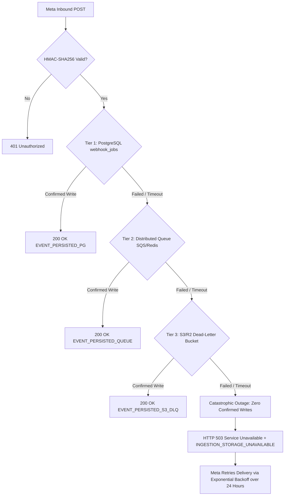
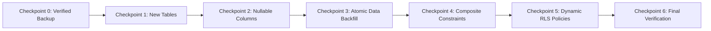

# MustafaH-AI — Multi-Clinic SaaS Architectural Specification
**Version:** 2.1.0 (Comprehensive Enterprise Multi-Tenant Blueprint)  
**Status:** DRAFT SPECIFICATION & AUDIT (Pending User Approval — Zero Database/Code Changes Executed)  
**Document Classification:** Mission-Critical Healthcare SaaS Architecture  
**Founding Pilot Tenant:** Dr. Mustafa Hadi (`@drmustafa_hadi` — Personal Dental Brand)  
**Quarantined Demo Tenant:** Almeswak Dental Clinic (`@almeswaksmile.iq` — Strictly Locked in Demo Mode)  

---

## Executive Architectural Summary

MustafaH-AI is evolving from a single-clinic Instagram assistant into an **Enterprise Multi-Clinic Dental SaaS Platform**. The platform will host multiple independent dental practices across Baghdad and Iraq on a unified, high-performance infrastructure while guaranteeing **cryptographic, operational, and relational tenant isolation**.

### Uncompromising Platform Principles
1. **Pilot Continuity:** Dr. Mustafa Hadi (`@drmustafa_hadi`) is preserved as the founding tenant (`org_drmustafa_hadi`). All 213 passing automated tests and historical clinic records will transition seamlessly with zero downtime.
2. **Clinic Workspace Protection:** Almeswak Dental Clinic (`@almeswaksmile.iq`) remains quarantined in Demo Mode without live credentials or outbound message capabilities until clinic management authorizes activation.
3. **Immutable Orthodontic Pricing Prohibition:** The prohibition against disclosing orthodontic prices, ranges, down payments, or installment plans via automated channels is an **immutable platform-level policy**. No clinic owner, staff role, plan tier, or tenant configuration can disable or override this restriction.
4. **Relational Tenant Consistency:** Cross-table references (such as an appointment referencing a patient lead, or a message referencing a conversation) must be constrained at the PostgreSQL engine level via **composite foreign keys**, preventing cross-tenant data contamination even in the presence of application-level bugs.
5. **No Ephemeral Local Buffer on Serverless:** Production webhook ingestion resilience must operate strictly on verified durable storage. Ephemeral serverless filesystems (`/tmp`) are explicitly rejected as recovery mechanisms.
6. **Zero-Trust Multi-Tenancy:** No clinic may ever view, mutate, or inherit another clinic's branding, location, phone number, clinical FAQs, leads, conversations, or access tokens.

---

## 1. Database Ownership & Isolation Matrix for All 12 Existing Tables

Every existing table from Phases 1–4 has been audited. The table below specifies its exact multi-tenant ownership model, foreign key strategy, indexing, and migration path.

| # | Existing Table | Primary Tenant Key | Ownership Type | Foreign Key & Referential Action | Composite Index / Constraints | Data Backfill Strategy |
|---|---|---|---|---|---|---|
| **1** | `instagram_accounts` | `organization_id UUID` | Direct Tenant Asset | `REFERENCES public.organizations(id) ON DELETE CASCADE` | `UNIQUE(organization_id, handle)`<br>`INDEX(organization_id, status)` | Map `'drmustafa_hadi'` to Dr. Mustafa's org; map `'almeswaksmile_iq'` to Almeswak org. |
| **2** | `leads` | `organization_id UUID` | Direct Tenant Data | `REFERENCES public.organizations(id) ON DELETE CASCADE` | `UNIQUE(organization_id, id)`<br>`INDEX(organization_id, status)`<br>`INDEX(organization_id, phone)` | Backfill `organization_id` matching `account_id` mapping. |
| **3** | `appointments` | `organization_id UUID` | Direct Tenant Data | `REFERENCES public.organizations(id) ON DELETE CASCADE`<br>`COMPOSITE FK (organization_id, lead_id) REFERENCES public.leads(organization_id, id) ON DELETE SET NULL` | `INDEX(organization_id, preferred_date)`<br>`INDEX(organization_id, status)` | Backfill `organization_id` matching `account_id` mapping. |
| **4** | `conversations` | `organization_id UUID` | Direct Tenant Data | `REFERENCES public.organizations(id) ON DELETE CASCADE` | `UNIQUE(organization_id, id)`<br>`INDEX(organization_id, status)` | Backfill `organization_id` matching `account_id` mapping. |
| **5** | `chat_messages` | `organization_id UUID` | Dual: Direct & Parent | `REFERENCES public.organizations(id) ON DELETE CASCADE`<br>`COMPOSITE FK (organization_id, conversation_id) REFERENCES public.conversations(organization_id, id) ON DELETE CASCADE` | `INDEX(organization_id, conversation_id)`<br>`INDEX(conversation_id, timestamp)` | Backfill `organization_id` via join to parent `conversations.organization_id`. |
| **6** | `content_items` | `organization_id UUID` | Direct Tenant Asset | `REFERENCES public.organizations(id) ON DELETE CASCADE` | `INDEX(organization_id, scheduled_date)`<br>`INDEX(organization_id, status)` | Backfill `organization_id` matching `account_id` mapping. |
| **7** | `ad_campaigns` | `organization_id UUID` | Direct Tenant Asset | `REFERENCES public.organizations(id) ON DELETE CASCADE` | `INDEX(organization_id, status)` | Backfill `organization_id` matching `account_id` mapping. |
| **8** | `webhook_logs` | `organization_id UUID` (Nullable) | System Audit Log | `REFERENCES public.organizations(id) ON DELETE SET NULL` | `INDEX(organization_id, created_at)`<br>`INDEX(status, created_at)` | Backfill where `sender_id` or recipient correlates to known pilot account. **Explicitly Nullable** (see rationale below). |
| **9** | `processed_webhook_messages` | `organization_id UUID` | Direct Reliability Store | `REFERENCES public.organizations(id) ON DELETE CASCADE` | `PRIMARY KEY (organization_id, message_id)`<br>`INDEX(organization_id, sender_id)` | Transform PK from `(message_id)` to composite `(organization_id, message_id)`. |
| **10** | `human_takeovers` | `organization_id UUID` | Direct Reliability Store | `REFERENCES public.organizations(id) ON DELETE CASCADE`<br>`COMPOSITE FK (organization_id, conversation_id) REFERENCES public.conversations(organization_id, id) ON DELETE SET NULL` | `UNIQUE(organization_id, sender_id) WHERE is_active = TRUE`<br>`INDEX(organization_id, sender_id)` | Update partial unique index to include `organization_id`. |
| **11** | `escalation_events` | `organization_id UUID` | Direct Audit Log | `REFERENCES public.organizations(id) ON DELETE CASCADE`<br>`COMPOSITE FK (organization_id, conversation_id) REFERENCES public.conversations(organization_id, id) ON DELETE SET NULL` | `INDEX(organization_id, event_type)`<br>`INDEX(organization_id, requires_followup)` | Backfill `organization_id` matching `account_id` mapping. |
| **12** | `webhook_jobs` | `organization_id UUID` | Direct Queue Task | `REFERENCES public.organizations(id) ON DELETE CASCADE` | `UNIQUE(organization_id, message_id)`<br>`INDEX(organization_id, status, attempts)` | Backfill `organization_id` matching `account_id` mapping. |

### 1.1 Rationale for Nullable `organization_id` on `webhook_logs`
Incoming HTTP webhook calls from Meta or third-party web scrapers hit the public ingestion endpoint (`/api/webhooks/instagram`) prior to authentication or account lookup. These requests may:
1. Fail HMAC-SHA256 signature verification (spoofed/malicious requests).
2. Carry a recipient ID that does not map to any registered organization in the database.
3. Be health checks or malformed JSON payloads.

If `webhook_logs.organization_id` were enforced as `NOT NULL`, recording security rejections or unregistered incoming events would throw a database constraint violation. This would destroy forensic telemetry precisely when security monitoring is most critical. Therefore, `webhook_logs.organization_id` remains **nullable with `ON DELETE SET NULL`**.

---

## 2. Complete Multi-Tenant Database Schema DDL

```sql
-- Enable necessary cryptographic extensions
CREATE EXTENSION IF NOT EXISTS "uuid-ossp";
CREATE EXTENSION IF NOT EXISTS "pgcrypto";

-- =============================================================================
-- SECTION 1: CORE SAAS TENANCY TABLES
-- =============================================================================

-- 1. Organizations (Clinics)
CREATE TABLE IF NOT EXISTS public.organizations (
    id UUID PRIMARY KEY DEFAULT gen_random_uuid(),
    slug TEXT NOT NULL UNIQUE, -- e.g. 'dr-mustafa-hadi', 'almeswak-baghdad'
    name TEXT NOT NULL,
    name_ar TEXT NOT NULL,
    status TEXT NOT NULL DEFAULT 'active' CHECK (status IN ('active', 'suspended', 'trialing', 'demo_mode')),
    tier TEXT NOT NULL DEFAULT 'starter' CHECK (tier IN ('starter', 'professional', 'enterprise')),
    created_at TIMESTAMPTZ NOT NULL DEFAULT NOW(),
    updated_at TIMESTAMPTZ NOT NULL DEFAULT NOW()
);

-- 2. Clinic Branches (Multi-Branch Support)
CREATE TABLE IF NOT EXISTS public.branches (
    id UUID PRIMARY KEY DEFAULT gen_random_uuid(),
    organization_id UUID NOT NULL REFERENCES public.organizations(id) ON DELETE CASCADE,
    slug TEXT NOT NULL,
    name TEXT NOT NULL,
    name_ar TEXT NOT NULL,
    city_ar TEXT NOT NULL DEFAULT 'بغداد',
    location_ar TEXT NOT NULL,
    emergency_phone TEXT NOT NULL,
    working_hours_ar TEXT NOT NULL,
    is_active BOOLEAN NOT NULL DEFAULT TRUE,
    created_at TIMESTAMPTZ NOT NULL DEFAULT NOW(),
    updated_at TIMESTAMPTZ NOT NULL DEFAULT NOW(),
    UNIQUE(organization_id, slug)
);

CREATE INDEX IF NOT EXISTS idx_branches_org ON public.branches(organization_id);

-- 3. Organization Members & Role-Based Access Control (RBAC)
CREATE TABLE IF NOT EXISTS public.organization_members (
    id UUID PRIMARY KEY DEFAULT gen_random_uuid(),
    organization_id UUID NOT NULL REFERENCES public.organizations(id) ON DELETE CASCADE,
    user_id UUID NOT NULL REFERENCES auth.users(id) ON DELETE CASCADE,
    branch_id UUID REFERENCES public.branches(id) ON DELETE SET NULL, -- Null implies all branches
    role TEXT NOT NULL CHECK (role IN ('owner', 'admin', 'dentist', 'receptionist', 'staff')),
    is_active BOOLEAN NOT NULL DEFAULT TRUE,
    created_at TIMESTAMPTZ NOT NULL DEFAULT NOW(),
    updated_at TIMESTAMPTZ NOT NULL DEFAULT NOW(),
    UNIQUE(organization_id, user_id)
);

CREATE INDEX IF NOT EXISTS idx_org_members_user ON public.organization_members(user_id);
CREATE INDEX IF NOT EXISTS idx_org_members_org ON public.organization_members(organization_id);

-- 4. Dynamic Tenant AI Configuration & Clinical Persona
CREATE TABLE IF NOT EXISTS public.tenant_ai_configs (
    id UUID PRIMARY KEY DEFAULT gen_random_uuid(),
    organization_id UUID NOT NULL UNIQUE REFERENCES public.organizations(id) ON DELETE CASCADE,
    assistant_name_ar TEXT NOT NULL DEFAULT 'المساعد الذكي',
    doctor_name_ar TEXT NOT NULL,
    slogan_ar TEXT,
    primary_location_ar TEXT NOT NULL,
    emergency_phone TEXT NOT NULL DEFAULT '07768886667',
    working_hours_ar TEXT NOT NULL,
    dialect_mode TEXT NOT NULL DEFAULT 'iraqi_baghdadi',
    custom_rules JSONB NOT NULL DEFAULT '[]'::jsonb,
    approved_services JSONB NOT NULL DEFAULT '[]'::jsonb,
    is_ortho_pricing_prohibited BOOLEAN NOT NULL DEFAULT TRUE CHECK (is_ortho_pricing_prohibited = TRUE), -- IMMUTABLE PLATFORM INVARIANT
    created_at TIMESTAMPTZ NOT NULL DEFAULT NOW(),
    updated_at TIMESTAMPTZ NOT NULL DEFAULT NOW()
);

-- 5. Organization Integrations & Encrypted Credentials (AEAD)
CREATE TABLE IF NOT EXISTS public.organization_integrations (
    id UUID PRIMARY KEY DEFAULT gen_random_uuid(),
    organization_id UUID NOT NULL REFERENCES public.organizations(id) ON DELETE CASCADE,
    branch_id UUID REFERENCES public.branches(id) ON DELETE SET NULL,
    provider TEXT NOT NULL DEFAULT 'instagram_graph_api' CHECK (provider IN ('instagram_graph_api', 'whatsapp_business')),
    platform_account_id TEXT NOT NULL UNIQUE, -- Meta Page ID or Instagram Business Account ID
    platform_account_handle TEXT,
    encrypted_access_token TEXT NOT NULL,
    token_iv TEXT NOT NULL,
    token_auth_tag TEXT NOT NULL,
    key_version INTEGER NOT NULL DEFAULT 1,
    token_expires_at TIMESTAMPTZ,
    status TEXT NOT NULL DEFAULT 'connected' CHECK (status IN ('connected', 'demo_mode', 'disconnected', 'expired')),
    last_verified_at TIMESTAMPTZ,
    last_error_message TEXT,
    created_at TIMESTAMPTZ NOT NULL DEFAULT NOW(),
    updated_at TIMESTAMPTZ NOT NULL DEFAULT NOW()
);

CREATE INDEX IF NOT EXISTS idx_integrations_platform ON public.organization_integrations(platform_account_id);
CREATE INDEX IF NOT EXISTS idx_integrations_org ON public.organization_integrations(organization_id);

-- =============================================================================
-- SECTION 2: SUBSCRIPTIONS, ENTITLEMENTS & CONCURRENCY-SAFE METERING
-- =============================================================================

-- 6. Subscription Plans (Catalog)
CREATE TABLE IF NOT EXISTS public.plans (
    id TEXT PRIMARY KEY, -- 'starter', 'professional', 'enterprise'
    name TEXT NOT NULL,
    name_ar TEXT NOT NULL,
    description_ar TEXT NOT NULL,
    monthly_price_usd NUMERIC(8, 2) NOT NULL DEFAULT 0.00, -- Placeholder pending business review
    annual_discount_percentage NUMERIC(4, 2) NOT NULL DEFAULT 0.15,
    monthly_dm_quota INTEGER NOT NULL,
    max_staff_seats INTEGER NOT NULL,
    max_branches INTEGER NOT NULL DEFAULT 1,
    is_active BOOLEAN NOT NULL DEFAULT TRUE,
    created_at TIMESTAMPTZ NOT NULL DEFAULT NOW(),
    updated_at TIMESTAMPTZ NOT NULL DEFAULT NOW()
);

-- Seed Plan Catalog (Placeholders)
INSERT INTO public.plans (id, name, name_ar, description_ar, monthly_price_usd, monthly_dm_quota, max_staff_seats, max_branches)
VALUES 
('starter', 'Starter Clinic', 'باقة العيادة الفردية', 'مخصصة للعيادات الفردية وأطباء الأسنان المستقلين', 49.00, 500, 2, 1),
('professional', 'Professional Clinic', 'باقة العيادة التخصصية', 'للعيادات التخصصية التي تحتاج إلى تخصيص أكبر ودعم حسابين', 149.00, 2500, 5, 2),
('enterprise', 'Enterprise Dental Center', 'باقة المراكز الكبرى', 'للمراكز التخصصية متعددة الفروع والأطباء', 299.00, 10000, 999, 10)
ON CONFLICT (id) DO NOTHING;

-- 7. Organization Subscriptions
CREATE TABLE IF NOT EXISTS public.subscriptions (
    id UUID PRIMARY KEY DEFAULT gen_random_uuid(),
    organization_id UUID NOT NULL UNIQUE REFERENCES public.organizations(id) ON DELETE CASCADE,
    plan_id TEXT NOT NULL REFERENCES public.plans(id) ON DELETE RESTRICT,
    status TEXT NOT NULL CHECK (status IN ('trialing', 'active', 'past_due', 'canceled', 'unpaid')),
    current_period_start TIMESTAMPTZ NOT NULL DEFAULT NOW(),
    current_period_end TIMESTAMPTZ NOT NULL DEFAULT NOW() + INTERVAL '30 days',
    cancel_at_period_end BOOLEAN NOT NULL DEFAULT FALSE,
    created_at TIMESTAMPTZ NOT NULL DEFAULT NOW(),
    updated_at TIMESTAMPTZ NOT NULL DEFAULT NOW()
);

CREATE INDEX IF NOT EXISTS idx_subscriptions_org ON public.subscriptions(organization_id);

-- 8. Subscription Entitlements (Feature Flags per Tenant)
CREATE TABLE IF NOT EXISTS public.subscription_entitlements (
    id UUID PRIMARY KEY DEFAULT gen_random_uuid(),
    subscription_id UUID NOT NULL REFERENCES public.subscriptions(id) ON DELETE CASCADE,
    feature_key TEXT NOT NULL, -- 'content_studio', 'multi_branch', 'custom_faq', 'direct_takeover'
    is_enabled BOOLEAN NOT NULL DEFAULT TRUE,
    feature_limit INTEGER, -- NULL implies unlimited
    created_at TIMESTAMPTZ NOT NULL DEFAULT NOW(),
    UNIQUE(subscription_id, feature_key)
);

-- 9. Concurrency-Safe Usage Records (Auditable Metering Ledger)
CREATE TABLE IF NOT EXISTS public.subscription_usage_records (
    id UUID PRIMARY KEY DEFAULT gen_random_uuid(),
    organization_id UUID NOT NULL REFERENCES public.organizations(id) ON DELETE CASCADE,
    period_start TIMESTAMPTZ NOT NULL,
    period_end TIMESTAMPTZ NOT NULL,
    dms_consumed INTEGER NOT NULL DEFAULT 0,
    allocated_quota INTEGER NOT NULL,
    created_at TIMESTAMPTZ NOT NULL DEFAULT NOW(),
    updated_at TIMESTAMPTZ NOT NULL DEFAULT NOW(),
    UNIQUE(organization_id, period_start)
);

CREATE INDEX IF NOT EXISTS idx_usage_org_period ON public.subscription_usage_records(organization_id, period_start);
```

---

## 3. Database-Level Tenant Relationships (Composite Foreign Keys)

Application-level filtering alone is insufficient to guarantee healthcare data isolation. To physically prevent an appointment belonging to Clinic B from referencing a lead belonging to Clinic A, the schema enforces **composite foreign keys**:

```sql
-- 1. Enforce unique tenant composite keys on parent tables
ALTER TABLE public.leads ADD CONSTRAINT uq_leads_org_id UNIQUE (organization_id, id);
ALTER TABLE public.conversations ADD CONSTRAINT uq_conversations_org_id UNIQUE (organization_id, id);

-- 2. Composite Foreign Key on appointments referencing leads
-- Guarantees that lead_id belongs to the EXACT SAME organization_id
ALTER TABLE public.appointments
    DROP CONSTRAINT IF EXISTS fk_appointments_lead_composite,
    ADD CONSTRAINT fk_appointments_lead_composite
    FOREIGN KEY (organization_id, lead_id)
    REFERENCES public.leads(organization_id, id)
    ON DELETE SET NULL;

-- 3. Composite Foreign Key on chat_messages referencing conversations
-- Guarantees that message belongs to the EXACT SAME organization_id as the conversation
ALTER TABLE public.chat_messages
    DROP CONSTRAINT IF EXISTS fk_messages_conv_composite,
    ADD CONSTRAINT fk_messages_conv_composite
    FOREIGN KEY (organization_id, conversation_id)
    REFERENCES public.conversations(organization_id, id)
    ON DELETE CASCADE;

-- 4. Composite Foreign Key on human_takeovers referencing conversations
ALTER TABLE public.human_takeovers
    DROP CONSTRAINT IF EXISTS fk_takeovers_conv_composite,
    ADD CONSTRAINT fk_takeovers_conv_composite
    FOREIGN KEY (organization_id, conversation_id)
    REFERENCES public.conversations(organization_id, id)
    ON DELETE SET NULL;

-- 5. Composite Foreign Key on escalation_events referencing conversations
ALTER TABLE public.escalation_events
    DROP CONSTRAINT IF EXISTS fk_escalations_conv_composite,
    ADD CONSTRAINT fk_escalations_conv_composite
    FOREIGN KEY (organization_id, conversation_id)
    REFERENCES public.conversations(organization_id, id)
    ON DELETE SET NULL;
```

---

## 4. Complete Row Level Security (RLS) Policy Specifications

### 4.1 System-Managed vs. Authenticated-Accessible Matrix

| Table | Direct Staff Access | Allowed Operations | Exclusively System-Managed Operations |
|---|:---:|---|---|
| `organizations` | Authenticated | SELECT (own), UPDATE (owner/admin) | INSERT (onboarding function only), DELETE (owner MFA only) |
| `branches` | Authenticated | SELECT, INSERT, UPDATE, DELETE (admin/owner) | Branch usage quota enforcement |
| `organization_members` | Authenticated | SELECT (org), INSERT/UPDATE/DELETE (owner/admin) | Owner demotion protection |
| `tenant_ai_configs` | Authenticated | SELECT, UPDATE (admin/owner) | `is_ortho_pricing_prohibited` is locked |
| `organization_integrations` | Authenticated | SELECT, INSERT, UPDATE, DELETE (admin/owner) | Background health probing & error logging |
| `plans` | Authenticated & Anon | SELECT | INSERT, UPDATE, DELETE (platform superadmin only) |
| `subscriptions` | Authenticated | SELECT | INSERT, UPDATE (billing worker / Stripe / admin only) |
| `subscription_entitlements` | Authenticated | SELECT | INSERT, UPDATE (billing engine only) |
| `subscription_usage_records` | Authenticated | SELECT (read-only audit) | INSERT, UPDATE (atomic reservation function only) |
| `instagram_accounts` | Authenticated | SELECT, INSERT, UPDATE, DELETE (admin/owner) | Background sync |
| `leads` | Authenticated | SELECT, INSERT, UPDATE, DELETE (staff/admin) | Automated scoring |
| `appointments` | Authenticated | SELECT, INSERT, UPDATE, DELETE (staff/admin) | Automated intake |
| `conversations` | Authenticated | SELECT, INSERT, UPDATE, DELETE (staff/admin) | Webhook intake |
| `chat_messages` | Authenticated | SELECT, INSERT, UPDATE (staff) | Webhook intake & AI replies |
| `content_items` | Authenticated | SELECT, INSERT, UPDATE, DELETE (staff/admin) | Studio generator |
| `ad_campaigns` | Authenticated | SELECT, INSERT, UPDATE, DELETE (admin/owner) | Ad spend telemetry |
| `webhook_logs` | Authenticated (Admin) | SELECT (admin only) | INSERT (edge webhook handler only; no manual writes) |
| `processed_webhook_messages`| Authenticated (Admin) | SELECT (admin debug only) | **EXCLUSIVELY SYSTEM-MANAGED:** INSERT/UPDATE/DELETE prohibited to staff |
| `human_takeovers` | Authenticated | SELECT, INSERT, UPDATE (staff/dentist) | Automated escalation handoff |
| `escalation_events` | Authenticated | SELECT, UPDATE (resolve only) | **INSERT is System-Managed; DELETE is PROHIBITED** |
| `webhook_jobs` | Authenticated (Admin) | SELECT (admin queue review) | **EXCLUSIVELY SYSTEM-MANAGED:** INSERT/UPDATE/DELETE prohibited to staff |

---

### 4.2 Hardened RLS Helper Functions (SECURITY DEFINER)

```sql
-- Secure function resolving caller active organizations
CREATE OR REPLACE FUNCTION public.get_auth_org_ids()
RETURNS TABLE (org_id UUID)
LANGUAGE sql
STABLE
SECURITY DEFINER
SET search_path = public, pg_temp
AS $$
    SELECT organization_id
    FROM public.organization_members
    WHERE user_id = auth.uid()
      AND is_active = TRUE;
$$;

-- Secure function verifying specific role permissions
CREATE OR REPLACE FUNCTION public.auth_has_role(target_org_id UUID, allowed_roles TEXT[])
RETURNS BOOLEAN
LANGUAGE sql
STABLE
SECURITY DEFINER
SET search_path = public, pg_temp
AS $$
    SELECT EXISTS (
        SELECT 1
        FROM public.organization_members
        WHERE user_id = auth.uid()
          AND organization_id = target_org_id
          AND is_active = TRUE
          AND role = ANY(allowed_roles)
    );
$$;

-- Hardened ownership and privilege enforcement
ALTER FUNCTION public.get_auth_org_ids() OWNER TO postgres;
ALTER FUNCTION public.auth_has_role(UUID, TEXT[]) OWNER TO postgres;

REVOKE ALL ON FUNCTION public.get_auth_org_ids() FROM PUBLIC;
GRANT EXECUTE ON FUNCTION public.get_auth_org_ids() TO authenticated, service_role;

REVOKE ALL ON FUNCTION public.auth_has_role(UUID, TEXT[]) FROM PUBLIC;
GRANT EXECUTE ON FUNCTION public.auth_has_role(UUID, TEXT[]) TO authenticated, service_role;
```

---

### 4.3 Production RLS Policies: New SaaS Tables

```sql
-- =============================================================================
-- organizations
-- =============================================================================
ALTER TABLE public.organizations ENABLE ROW LEVEL SECURITY;

CREATE POLICY "org_select_members" ON public.organizations
    FOR SELECT TO authenticated
    USING (id IN (SELECT org_id FROM public.get_auth_org_ids()));

CREATE POLICY "org_update_owner" ON public.organizations
    FOR UPDATE TO authenticated
    USING (public.auth_has_role(id, ARRAY['owner']))
    WITH CHECK (public.auth_has_role(id, ARRAY['owner']));

CREATE POLICY "org_service_role" ON public.organizations
    FOR ALL TO service_role
    USING (true) WITH CHECK (true);

-- =============================================================================
-- branches
-- =============================================================================
ALTER TABLE public.branches ENABLE ROW LEVEL SECURITY;

CREATE POLICY "branches_select_members" ON public.branches
    FOR SELECT TO authenticated
    USING (organization_id IN (SELECT org_id FROM public.get_auth_org_ids()));

CREATE POLICY "branches_insert_admin" ON public.branches
    FOR INSERT TO authenticated
    WITH CHECK (public.auth_has_role(organization_id, ARRAY['owner', 'admin']));

CREATE POLICY "branches_update_admin" ON public.branches
    FOR UPDATE TO authenticated
    USING (public.auth_has_role(organization_id, ARRAY['owner', 'admin']))
    WITH CHECK (public.auth_has_role(organization_id, ARRAY['owner', 'admin']));

CREATE POLICY "branches_delete_owner" ON public.branches
    FOR DELETE TO authenticated
    USING (public.auth_has_role(organization_id, ARRAY['owner']));

CREATE POLICY "branches_service_role" ON public.branches
    FOR ALL TO service_role
    USING (true) WITH CHECK (true);

-- =============================================================================
-- organization_members
-- =============================================================================
ALTER TABLE public.organization_members ENABLE ROW LEVEL SECURITY;

CREATE POLICY "members_select_colleagues" ON public.organization_members
    FOR SELECT TO authenticated
    USING (organization_id IN (SELECT org_id FROM public.get_auth_org_ids()));

CREATE POLICY "members_insert_admin" ON public.organization_members
    FOR INSERT TO authenticated
    WITH CHECK (public.auth_has_role(organization_id, ARRAY['owner', 'admin']));

CREATE POLICY "members_update_admin" ON public.organization_members
    FOR UPDATE TO authenticated
    USING (public.auth_has_role(organization_id, ARRAY['owner', 'admin']))
    WITH CHECK (public.auth_has_role(organization_id, ARRAY['owner', 'admin']));

CREATE POLICY "members_delete_admin" ON public.organization_members
    FOR DELETE TO authenticated
    USING (public.auth_has_role(organization_id, ARRAY['owner', 'admin']) AND user_id != auth.uid());

CREATE POLICY "members_service_role" ON public.organization_members
    FOR ALL TO service_role
    USING (true) WITH CHECK (true);

-- =============================================================================
-- tenant_ai_configs
-- =============================================================================
ALTER TABLE public.tenant_ai_configs ENABLE ROW LEVEL SECURITY;

CREATE POLICY "ai_config_select_members" ON public.tenant_ai_configs
    FOR SELECT TO authenticated
    USING (organization_id IN (SELECT org_id FROM public.get_auth_org_ids()));

CREATE POLICY "ai_config_update_admin" ON public.tenant_ai_configs
    FOR UPDATE TO authenticated
    USING (public.auth_has_role(organization_id, ARRAY['owner', 'admin']))
    WITH CHECK (public.auth_has_role(organization_id, ARRAY['owner', 'admin']));

CREATE POLICY "ai_config_service_role" ON public.tenant_ai_configs
    FOR ALL TO service_role
    USING (true) WITH CHECK (true);

-- =============================================================================
-- organization_integrations
-- =============================================================================
ALTER TABLE public.organization_integrations ENABLE ROW LEVEL SECURITY;

CREATE POLICY "integrations_select_admin" ON public.organization_integrations
    FOR SELECT TO authenticated
    USING (public.auth_has_role(organization_id, ARRAY['owner', 'admin']));

CREATE POLICY "integrations_insert_admin" ON public.organization_integrations
    FOR INSERT TO authenticated
    WITH CHECK (public.auth_has_role(organization_id, ARRAY['owner', 'admin']));

CREATE POLICY "integrations_update_admin" ON public.organization_integrations
    FOR UPDATE TO authenticated
    USING (public.auth_has_role(organization_id, ARRAY['owner', 'admin']))
    WITH CHECK (public.auth_has_role(organization_id, ARRAY['owner', 'admin']));

CREATE POLICY "integrations_delete_owner" ON public.organization_integrations
    FOR DELETE TO authenticated
    USING (public.auth_has_role(organization_id, ARRAY['owner']));

CREATE POLICY "integrations_service_role" ON public.organization_integrations
    FOR ALL TO service_role
    USING (true) WITH CHECK (true);

-- =============================================================================
-- plans & subscriptions & usage
-- =============================================================================
ALTER TABLE public.plans ENABLE ROW LEVEL SECURITY;
CREATE POLICY "plans_read_public" ON public.plans FOR SELECT TO authenticated, anon USING (is_active = TRUE);
CREATE POLICY "plans_service_role" ON public.plans FOR ALL TO service_role USING (true) WITH CHECK (true);

ALTER TABLE public.subscriptions ENABLE ROW LEVEL SECURITY;
CREATE POLICY "subs_select_members" ON public.subscriptions FOR SELECT TO authenticated USING (organization_id IN (SELECT org_id FROM public.get_auth_org_ids()));
CREATE POLICY "subs_service_role" ON public.subscriptions FOR ALL TO service_role USING (true) WITH CHECK (true);

ALTER TABLE public.subscription_entitlements ENABLE ROW LEVEL SECURITY;
CREATE POLICY "entitlements_select_members" ON public.subscription_entitlements FOR SELECT TO authenticated
    USING (subscription_id IN (SELECT s.id FROM public.subscriptions s WHERE s.organization_id IN (SELECT org_id FROM public.get_auth_org_ids())));
CREATE POLICY "entitlements_service_role" ON public.subscription_entitlements FOR ALL TO service_role USING (true) WITH CHECK (true);

ALTER TABLE public.subscription_usage_records ENABLE ROW LEVEL SECURITY;
CREATE POLICY "usage_select_members" ON public.subscription_usage_records FOR SELECT TO authenticated USING (organization_id IN (SELECT org_id FROM public.get_auth_org_ids()));
CREATE POLICY "usage_service_role" ON public.subscription_usage_records FOR ALL TO service_role USING (true) WITH CHECK (true);
```

---

### 4.4 Production RLS Policies: All 12 Existing Tables (With Explicit Denials)

```sql
-- 1. instagram_accounts
ALTER TABLE public.instagram_accounts ENABLE ROW LEVEL SECURITY;
CREATE POLICY "acc_select" ON public.instagram_accounts FOR SELECT TO authenticated USING (organization_id IN (SELECT org_id FROM public.get_auth_org_ids()));
CREATE POLICY "acc_insert" ON public.instagram_accounts FOR INSERT TO authenticated WITH CHECK (public.auth_has_role(organization_id, ARRAY['owner', 'admin']));
CREATE POLICY "acc_update" ON public.instagram_accounts FOR UPDATE TO authenticated USING (public.auth_has_role(organization_id, ARRAY['owner', 'admin'])) WITH CHECK (public.auth_has_role(organization_id, ARRAY['owner', 'admin']));
CREATE POLICY "acc_delete" ON public.instagram_accounts FOR DELETE TO authenticated USING (public.auth_has_role(organization_id, ARRAY['owner']));
CREATE POLICY "acc_service" ON public.instagram_accounts FOR ALL TO service_role USING (true) WITH CHECK (true);

-- 2. leads
ALTER TABLE public.leads ENABLE ROW LEVEL SECURITY;
CREATE POLICY "leads_select" ON public.leads FOR SELECT TO authenticated USING (organization_id IN (SELECT org_id FROM public.get_auth_org_ids()));
CREATE POLICY "leads_insert" ON public.leads FOR INSERT TO authenticated WITH CHECK (organization_id IN (SELECT org_id FROM public.get_auth_org_ids()));
CREATE POLICY "leads_update" ON public.leads FOR UPDATE TO authenticated USING (public.auth_has_role(organization_id, ARRAY['owner', 'admin', 'dentist', 'receptionist'])) WITH CHECK (organization_id IN (SELECT org_id FROM public.get_auth_org_ids()));
CREATE POLICY "leads_delete" ON public.leads FOR DELETE TO authenticated USING (public.auth_has_role(organization_id, ARRAY['owner', 'admin']));
CREATE POLICY "leads_service" ON public.leads FOR ALL TO service_role USING (true) WITH CHECK (true);

-- 3. appointments
ALTER TABLE public.appointments ENABLE ROW LEVEL SECURITY;
CREATE POLICY "appts_select" ON public.appointments FOR SELECT TO authenticated USING (organization_id IN (SELECT org_id FROM public.get_auth_org_ids()));
CREATE POLICY "appts_insert" ON public.appointments FOR INSERT TO authenticated WITH CHECK (public.auth_has_role(organization_id, ARRAY['owner', 'admin', 'dentist', 'receptionist']));
CREATE POLICY "appts_update" ON public.appointments FOR UPDATE TO authenticated USING (public.auth_has_role(organization_id, ARRAY['owner', 'admin', 'dentist', 'receptionist'])) WITH CHECK (organization_id IN (SELECT org_id FROM public.get_auth_org_ids()));
CREATE POLICY "appts_delete" ON public.appointments FOR DELETE TO authenticated USING (public.auth_has_role(organization_id, ARRAY['owner', 'admin']));
CREATE POLICY "appts_service" ON public.appointments FOR ALL TO service_role USING (true) WITH CHECK (true);

-- 4. conversations
ALTER TABLE public.conversations ENABLE ROW LEVEL SECURITY;
CREATE POLICY "convs_select" ON public.conversations FOR SELECT TO authenticated USING (organization_id IN (SELECT org_id FROM public.get_auth_org_ids()));
CREATE POLICY "convs_insert" ON public.conversations FOR INSERT TO authenticated WITH CHECK (organization_id IN (SELECT org_id FROM public.get_auth_org_ids()));
CREATE POLICY "convs_update" ON public.conversations FOR UPDATE TO authenticated USING (public.auth_has_role(organization_id, ARRAY['owner', 'admin', 'dentist', 'receptionist'])) WITH CHECK (organization_id IN (SELECT org_id FROM public.get_auth_org_ids()));
CREATE POLICY "convs_delete" ON public.conversations FOR DELETE TO authenticated USING (public.auth_has_role(organization_id, ARRAY['owner', 'admin']));
CREATE POLICY "convs_service" ON public.conversations FOR ALL TO service_role USING (true) WITH CHECK (true);

-- 5. chat_messages
ALTER TABLE public.chat_messages ENABLE ROW LEVEL SECURITY;
CREATE POLICY "msgs_select" ON public.chat_messages FOR SELECT TO authenticated USING (organization_id IN (SELECT org_id FROM public.get_auth_org_ids()));
CREATE POLICY "msgs_insert" ON public.chat_messages FOR INSERT TO authenticated WITH CHECK (organization_id IN (SELECT org_id FROM public.get_auth_org_ids()));
CREATE POLICY "msgs_update" ON public.chat_messages FOR UPDATE TO authenticated USING (public.auth_has_role(organization_id, ARRAY['owner', 'admin', 'dentist', 'receptionist'])) WITH CHECK (organization_id IN (SELECT org_id FROM public.get_auth_org_ids()));
CREATE POLICY "msgs_delete" ON public.chat_messages FOR DELETE TO authenticated USING (public.auth_has_role(organization_id, ARRAY['owner', 'admin']));
CREATE POLICY "msgs_service" ON public.chat_messages FOR ALL TO service_role USING (true) WITH CHECK (true);

-- 6. content_items
ALTER TABLE public.content_items ENABLE ROW LEVEL SECURITY;
CREATE POLICY "cnt_select" ON public.content_items FOR SELECT TO authenticated USING (organization_id IN (SELECT org_id FROM public.get_auth_org_ids()));
CREATE POLICY "cnt_insert" ON public.content_items FOR INSERT TO authenticated WITH CHECK (public.auth_has_role(organization_id, ARRAY['owner', 'admin', 'dentist']));
CREATE POLICY "cnt_update" ON public.content_items FOR UPDATE TO authenticated USING (public.auth_has_role(organization_id, ARRAY['owner', 'admin', 'dentist'])) WITH CHECK (organization_id IN (SELECT org_id FROM public.get_auth_org_ids()));
CREATE POLICY "cnt_delete" ON public.content_items FOR DELETE TO authenticated USING (public.auth_has_role(organization_id, ARRAY['owner', 'admin']));
CREATE POLICY "cnt_service" ON public.content_items FOR ALL TO service_role USING (true) WITH CHECK (true);

-- 7. ad_campaigns
ALTER TABLE public.ad_campaigns ENABLE ROW LEVEL SECURITY;
CREATE POLICY "ad_select" ON public.ad_campaigns FOR SELECT TO authenticated USING (organization_id IN (SELECT org_id FROM public.get_auth_org_ids()));
CREATE POLICY "ad_insert" ON public.ad_campaigns FOR INSERT TO authenticated WITH CHECK (public.auth_has_role(organization_id, ARRAY['owner', 'admin']));
CREATE POLICY "ad_update" ON public.ad_campaigns FOR UPDATE TO authenticated USING (public.auth_has_role(organization_id, ARRAY['owner', 'admin'])) WITH CHECK (organization_id IN (SELECT org_id FROM public.get_auth_org_ids()));
CREATE POLICY "ad_delete" ON public.ad_campaigns FOR DELETE TO authenticated USING (public.auth_has_role(organization_id, ARRAY['owner']));
CREATE POLICY "ad_service" ON public.ad_campaigns FOR ALL TO service_role USING (true) WITH CHECK (true);

-- 8. webhook_logs (System Audit)
ALTER TABLE public.webhook_logs ENABLE ROW LEVEL SECURITY;
CREATE POLICY "logs_select_admin" ON public.webhook_logs FOR SELECT TO authenticated 
    USING (organization_id IN (SELECT org_id FROM public.get_auth_org_ids()) AND public.auth_has_role(organization_id, ARRAY['owner', 'admin']));
CREATE POLICY "logs_service" ON public.webhook_logs FOR ALL TO service_role USING (true) WITH CHECK (true);
-- INTENTIONAL DENIAL: Authenticated staff cannot INSERT, UPDATE, or DELETE webhook logs.

-- 9. processed_webhook_messages (Deduplication Engine)
ALTER TABLE public.processed_webhook_messages ENABLE ROW LEVEL SECURITY;
CREATE POLICY "dedup_select_admin" ON public.processed_webhook_messages FOR SELECT TO authenticated
    USING (organization_id IN (SELECT org_id FROM public.get_auth_org_ids()) AND public.auth_has_role(organization_id, ARRAY['owner', 'admin']));
CREATE POLICY "dedup_service" ON public.processed_webhook_messages FOR ALL TO service_role USING (true) WITH CHECK (true);
-- INTENTIONAL DENIAL: Staff cannot INSERT, UPDATE, or DELETE deduplication tokens.

-- 10. human_takeovers
ALTER TABLE public.human_takeovers ENABLE ROW LEVEL SECURITY;
CREATE POLICY "tk_select" ON public.human_takeovers FOR SELECT TO authenticated USING (organization_id IN (SELECT org_id FROM public.get_auth_org_ids()));
CREATE POLICY "tk_insert" ON public.human_takeovers FOR INSERT TO authenticated WITH CHECK (public.auth_has_role(organization_id, ARRAY['owner', 'admin', 'dentist', 'receptionist']));
CREATE POLICY "tk_update" ON public.human_takeovers FOR UPDATE TO authenticated USING (public.auth_has_role(organization_id, ARRAY['owner', 'admin', 'dentist', 'receptionist'])) WITH CHECK (organization_id IN (SELECT org_id FROM public.get_auth_org_ids()));
CREATE POLICY "tk_service" ON public.human_takeovers FOR ALL TO service_role USING (true) WITH CHECK (true);
-- INTENTIONAL DENIAL: Human takeover records cannot be deleted; they must be released via update.

-- 11. escalation_events (Immutable Security & Safety Audit Trail)
ALTER TABLE public.escalation_events ENABLE ROW LEVEL SECURITY;
CREATE POLICY "esc_select" ON public.escalation_events FOR SELECT TO authenticated USING (organization_id IN (SELECT org_id FROM public.get_auth_org_ids()));
CREATE POLICY "esc_update" ON public.escalation_events FOR UPDATE TO authenticated 
    USING (public.auth_has_role(organization_id, ARRAY['owner', 'admin', 'dentist', 'receptionist'])) WITH CHECK (organization_id IN (SELECT org_id FROM public.get_auth_org_ids()));
CREATE POLICY "esc_service" ON public.escalation_events FOR ALL TO service_role USING (true) WITH CHECK (true);
-- INTENTIONAL DENIAL: Neither staff nor admins may DELETE or manually INSERT escalation audit events.

-- 12. webhook_jobs (Asynchronous Queue)
ALTER TABLE public.webhook_jobs ENABLE ROW LEVEL SECURITY;
CREATE POLICY "jobs_select_admin" ON public.webhook_jobs FOR SELECT TO authenticated
    USING (organization_id IN (SELECT org_id FROM public.get_auth_org_ids()) AND public.auth_has_role(organization_id, ARRAY['owner', 'admin']));
CREATE POLICY "jobs_service" ON public.webhook_jobs FOR ALL TO service_role USING (true) WITH CHECK (true);
-- INTENTIONAL DENIAL: Background jobs are exclusively scheduled, dequeued, and mutated by service_role.
```

### 4.5 Service-Role Independent Tenancy Validation (Defense-in-Depth)
Because Supabase `service_role` bypasses PostgreSQL RLS, **application code must enforce tenant isolation independently**:
1. Every service-role query (whether in a webhook handler, queue worker, or cron task) **MUST** include `organization_id = $tenantId` in its SQL `WHERE` clause:
   ```typescript
   // COMPLIANT: Explicit tenant scope enforced even under service_role
   await supabaseAdmin
     .from('leads')
     .update({ status: 'contacted' })
     .match({ id: leadId, organization_id: verifiedOrgId });
   ```
2. Any query lacking an explicit `organization_id` predicate is strictly rejected by our database client wrapper (`TenantScopedDbClient`).

---

## 5. Webhook Durability & Catastrophic Outage Architecture

### 5.1 Strict Rules for HTTP 200 Acknowledgment
> **Durability Principle:** The ingestion endpoint **MAY NOT** return HTTP 200 based on in-memory buffers or uncommitted state. **Zero-loss recovery is never claimed without a confirmed, durable write.**

HTTP `200 OK` is returned **only after** the raw payload is confirmed written to at least one of the following durable storage tiers:
1. **Tier 1 (Primary Database):** Successfully committed to PostgreSQL `webhook_jobs`.
2. **Tier 2 (Distributed Managed Queue):** Confirmed acknowledgment from Amazon SQS / Cloudflare Queue / Upstash Redis with multi-zone replication.
3. **Tier 3 (Immutable Object Storage DLQ):** Confirmed HTTP 200 from AWS S3 or Cloudflare R2 via presigned HTTPS PUT.

---

### 5.2 Catastrophic Outage Protocol (Postgres, Queue, and Object Storage All Down)



### 5.3 What Happens During a Catastrophic Multi-Cloud Outage?
If PostgreSQL, the distributed queue, and the object storage bucket are **simultaneously unavailable**:
1. **The System Strictly Returns HTTP 503 (Service Unavailable):**
   ```json
   {
     "error": "INGESTION_STORAGE_UNAVAILABLE",
     "message": "Zero durable write tiers available. Delivery rejected to trigger upstream sender retry."
   }
   ```
2. **Why HTTP 503 is Required:**  
   Returning 200 without a durable write would cause silent, unrecoverable data loss. Returning 503 explicitly informs Meta that the delivery was not accepted. Per official Meta Graph API specifications, Meta **retries failed webhook deliveries with exponential backoff over a 24-hour window** for HTTP status codes `5xx` and `4xx`.
3. **Reconciliation Upon Restoration:**
   - As soon as Tier 1, 2, or 3 recovers, incoming retries from Meta are durably ingested.
   - Any replayed message hits `processed_webhook_messages(organization_id, message_id)`. Duplicates are immediately discarded without sending repeated messages.
   - If Meta's retry arrives after $>24\text{ hours}$, the queue worker's mandatory 24-hour policy re-validation aborts automated dispatch and flags the conversation for manual receptionist outreach.

---

## 6. Integration Credential Encryption, Key Rotation & AEAD

### 6.1 Cryptographic Standard: AES-256-GCM with Associated Data (AEAD)
All Meta Page Access Tokens are encrypted using **AES-256-GCM**. To prevent **token substitution attacks** (where an attacker copies ciphertext belonging to Organization A into Organization B's table record), the encryption uses **Authenticated Additional Data (AAD)**:

$$\text{Ciphertext, AuthTag} = \text{AES-256-GCM-Encrypt}(\text{Key}, \text{IV}, \text{PlaintextToken}, \text{AAD})$$

$$\text{AAD} = \text{ASCII}(\text{organization\_id}) \parallel \text{ASCII}(\text{platform\_account\_id})$$

If ciphertext is copied to another organization, GCM decryption will immediately fail authentication tag validation, mathematically preventing cross-tenant credential reuse.

### 6.2 Key Versioning & Zero-Downtime Rotation
1. **Key Versioning:** `organization_integrations.key_version` tracks which master key encrypted the token (e.g. `v1`, `v2`).
2. **Key Ring:** Serverless runtime environment variables store the active encryption key ring:
   ```env
   INTEGRATION_KEY_CURRENT_VERSION=2
   INTEGRATION_KEY_V2=b64_32_byte_cryptographic_key_here...
   INTEGRATION_KEY_V1=b64_32_byte_older_key_here...
   ```
3. **Zero-Downtime Rotation Protocol:**
   - The system encrypts all new tokens with `INTEGRATION_KEY_CURRENT_VERSION`.
   - The system decrypts existing tokens using the key specified by `key_version`.
   - An offline re-encryption script (`scripts/rotate_integration_keys.ts`) iterates existing records, decrypts with `v1`, re-encrypts with `v2`, updates `key_version = 2`, and allows deprecation of `v1` with zero service interruption.

---

## 7. Concurrency-Safe SaaS Subscription & Usage Metering

### 7.1 Separation of Catalog, Subscriptions, Entitlements & Usage
1. `plans`: Global catalog defining tier limits and pricing placeholders.
2. `subscriptions`: Organization's active contract, billing period, and status.
3. `subscription_entitlements`: Feature toggles (e.g. `multi_branch`, `content_studio`).
4. `subscription_usage_records`: Immutable monthly audit ledger tracking consumed DMs.

### 7.2 Concurrency-Safe Atomic Quota Reservation Function
To prevent race conditions where concurrent webhook workers overshoot the monthly DM allowance:

```sql
CREATE OR REPLACE FUNCTION public.reserve_dm_quota(
    p_organization_id UUID,
    p_period_start TIMESTAMPTZ,
    p_period_end TIMESTAMPTZ,
    p_max_quota INTEGER
)
RETURNS BOOLEAN
LANGUAGE plpgsql
SECURITY DEFINER
SET search_path = public, pg_temp
AS $$
DECLARE
    v_updated INTEGER;
BEGIN
    -- Ensure usage record exists for the active billing period
    INSERT INTO public.subscription_usage_records (
        organization_id, period_start, period_end, dms_consumed, allocated_quota
    )
    VALUES (p_organization_id, p_period_start, p_period_end, 0, p_max_quota)
    ON CONFLICT (organization_id, period_start) DO NOTHING;

    -- Atomically reserve 1 unit ONLY IF within quota
    UPDATE public.subscription_usage_records
    SET dms_consumed = dms_consumed + 1,
        updated_at = NOW()
    WHERE organization_id = p_organization_id
      AND period_start = p_period_start
      AND dms_consumed < allocated_quota;

    GET DIAGNOSTICS v_updated = ROW_COUNT;
    RETURN v_updated > 0;
END;
$$;

ALTER FUNCTION public.reserve_dm_quota(UUID, TIMESTAMPTZ, TIMESTAMPTZ, INTEGER) OWNER TO postgres;
REVOKE ALL ON FUNCTION public.reserve_dm_quota FROM PUBLIC;
GRANT EXECUTE ON FUNCTION public.reserve_dm_quota TO service_role;
```

---

## 8. Checkpoint-Based Migration & Non-Destructive Rollback Strategy

Destructive statements like `DROP COLUMN CASCADE` are **strictly prohibited** in production healthcare databases. The migration plan uses a **checkpoint-based forward recovery strategy**.



### 8.1 Detailed Migration Checkpoints

#### Checkpoint 0: Pre-Migration Backup & Integrity Verification
```bash
# 1. Take a physical and logical backup
supabase db dump -f backup_phase4_pre_saas.sql
# 2. Verify all 213 tests pass
npx tsx scripts/test_engine.ts
npx tsx scripts/test_phase4_deployment.ts
```

#### Checkpoint 1: Deploy Core SaaS Tables
Execute DDL creating `organizations`, `branches`, `organization_members`, `tenant_ai_configs`, `organization_integrations`, `plans`, `subscriptions`, `subscription_entitlements`, and `subscription_usage_records`.

#### Checkpoint 2: Add Nullable `organization_id` to All 12 Tables
```sql
ALTER TABLE public.instagram_accounts ADD COLUMN IF NOT EXISTS organization_id UUID REFERENCES public.organizations(id);
ALTER TABLE public.leads ADD COLUMN IF NOT EXISTS organization_id UUID REFERENCES public.organizations(id);
ALTER TABLE public.appointments ADD COLUMN IF NOT EXISTS organization_id UUID REFERENCES public.organizations(id);
ALTER TABLE public.conversations ADD COLUMN IF NOT EXISTS organization_id UUID REFERENCES public.organizations(id);
ALTER TABLE public.chat_messages ADD COLUMN IF NOT EXISTS organization_id UUID REFERENCES public.organizations(id);
ALTER TABLE public.content_items ADD COLUMN IF NOT EXISTS organization_id UUID REFERENCES public.organizations(id);
ALTER TABLE public.ad_campaigns ADD COLUMN IF NOT EXISTS organization_id UUID REFERENCES public.organizations(id);
ALTER TABLE public.webhook_logs ADD COLUMN IF NOT EXISTS organization_id UUID REFERENCES public.organizations(id);
ALTER TABLE public.processed_webhook_messages ADD COLUMN IF NOT EXISTS organization_id UUID REFERENCES public.organizations(id);
ALTER TABLE public.human_takeovers ADD COLUMN IF NOT EXISTS organization_id UUID REFERENCES public.organizations(id);
ALTER TABLE public.escalation_events ADD COLUMN IF NOT EXISTS organization_id UUID REFERENCES public.organizations(id);
ALTER TABLE public.webhook_jobs ADD COLUMN IF NOT EXISTS organization_id UUID REFERENCES public.organizations(id);
```

#### Checkpoint 3: Seed Founding Tenants & Backfill Existing Data
```sql
-- Seed Dr. Mustafa Hadi as Founding Tenant
INSERT INTO public.organizations (id, slug, name, name_ar, status, tier)
VALUES ('d0000000-0000-0000-0000-000000000001', 'dr-mustafa-hadi', 'Dr. Mustafa Hadi', 'د. مصطفى هادي', 'active', 'enterprise')
ON CONFLICT (id) DO NOTHING;

-- Seed Almeswak Dental Clinic as Quarantined Demo Tenant
INSERT INTO public.organizations (id, slug, name, name_ar, status, tier)
VALUES ('c0000000-0000-0000-0000-000000000002', 'almeswaksmile-iq', 'Almeswak Dental Clinic', 'عيادة المسواك لطب وتجميل الأسنان', 'demo_mode', 'starter')
ON CONFLICT (id) DO NOTHING;

-- Backfill instagram_accounts
UPDATE public.instagram_accounts SET organization_id = 'd0000000-0000-0000-0000-000000000001' WHERE id = 'drmustafa_hadi' AND organization_id IS NULL;
UPDATE public.instagram_accounts SET organization_id = 'c0000000-0000-0000-0000-000000000002' WHERE id = 'almeswaksmile_iq' AND organization_id IS NULL;

-- Backfill all remaining 11 tables matching account_id
UPDATE public.leads SET organization_id = 'd0000000-0000-0000-0000-000000000001' WHERE account_id = 'drmustafa_hadi' AND organization_id IS NULL;
UPDATE public.leads SET organization_id = 'c0000000-0000-0000-0000-000000000002' WHERE account_id = 'almeswaksmile_iq' AND organization_id IS NULL;

UPDATE public.appointments SET organization_id = 'd0000000-0000-0000-0000-000000000001' WHERE account_id = 'drmustafa_hadi' AND organization_id IS NULL;
UPDATE public.appointments SET organization_id = 'c0000000-0000-0000-0000-000000000002' WHERE account_id = 'almeswaksmile_iq' AND organization_id IS NULL;

UPDATE public.conversations SET organization_id = 'd0000000-0000-0000-0000-000000000001' WHERE account_id = 'drmustafa_hadi' AND organization_id IS NULL;
UPDATE public.conversations SET organization_id = 'c0000000-0000-0000-0000-000000000002' WHERE account_id = 'almeswaksmile_iq' AND organization_id IS NULL;

-- Backfill chat_messages via parent conversation
UPDATE public.chat_messages m
SET organization_id = c.organization_id
FROM public.conversations c
WHERE m.conversation_id = c.id AND m.organization_id IS NULL;

UPDATE public.content_items SET organization_id = 'd0000000-0000-0000-0000-000000000001' WHERE account_id = 'drmustafa_hadi' AND organization_id IS NULL;
UPDATE public.content_items SET organization_id = 'c0000000-0000-0000-0000-000000000002' WHERE account_id = 'almeswaksmile_iq' AND organization_id IS NULL;

UPDATE public.ad_campaigns SET organization_id = 'd0000000-0000-0000-0000-000000000001' WHERE account_id = 'drmustafa_hadi' AND organization_id IS NULL;
UPDATE public.ad_campaigns SET organization_id = 'c0000000-0000-0000-0000-000000000002' WHERE account_id = 'almeswaksmile_iq' AND organization_id IS NULL;

UPDATE public.processed_webhook_messages SET organization_id = 'd0000000-0000-0000-0000-000000000001' WHERE account_id = 'drmustafa_hadi' AND organization_id IS NULL;
UPDATE public.processed_webhook_messages SET organization_id = 'c0000000-0000-0000-0000-000000000002' WHERE account_id = 'almeswaksmile_iq' AND organization_id IS NULL;

UPDATE public.human_takeovers SET organization_id = 'd0000000-0000-0000-0000-000000000001' WHERE account_id = 'drmustafa_hadi' AND organization_id IS NULL;
UPDATE public.human_takeovers SET organization_id = 'c0000000-0000-0000-0000-000000000002' WHERE account_id = 'almeswaksmile_iq' AND organization_id IS NULL;

UPDATE public.escalation_events SET organization_id = 'd0000000-0000-0000-0000-000000000001' WHERE account_id = 'drmustafa_hadi' AND organization_id IS NULL;
UPDATE public.escalation_events SET organization_id = 'c0000000-0000-0000-0000-000000000002' WHERE account_id = 'almeswaksmile_iq' AND organization_id IS NULL;

UPDATE public.webhook_jobs SET organization_id = 'd0000000-0000-0000-0000-000000000001' WHERE account_id = 'drmustafa_hadi' AND organization_id IS NULL;
UPDATE public.webhook_jobs SET organization_id = 'c0000000-0000-0000-0000-000000000002' WHERE account_id = 'almeswaksmile_iq' AND organization_id IS NULL;
```

#### Checkpoint 4: Enforce Constraints & Transform Primary Keys
```sql
-- Enforce NOT NULL on tenant-owned tables
ALTER TABLE public.instagram_accounts ALTER COLUMN organization_id SET NOT NULL;
ALTER TABLE public.leads ALTER COLUMN organization_id SET NOT NULL;
ALTER TABLE public.appointments ALTER COLUMN organization_id SET NOT NULL;
ALTER TABLE public.conversations ALTER COLUMN organization_id SET NOT NULL;
ALTER TABLE public.chat_messages ALTER COLUMN organization_id SET NOT NULL;
ALTER TABLE public.content_items ALTER COLUMN organization_id SET NOT NULL;
ALTER TABLE public.ad_campaigns ALTER COLUMN organization_id SET NOT NULL;
ALTER TABLE public.processed_webhook_messages ALTER COLUMN organization_id SET NOT NULL;
ALTER TABLE public.human_takeovers ALTER COLUMN organization_id SET NOT NULL;
ALTER TABLE public.escalation_events ALTER COLUMN organization_id SET NOT NULL;
ALTER TABLE public.webhook_jobs ALTER COLUMN organization_id SET NOT NULL;

-- Transform processed_webhook_messages Primary Key to composite
ALTER TABLE public.processed_webhook_messages DROP CONSTRAINT IF EXISTS processed_webhook_messages_pkey;
ALTER TABLE public.processed_webhook_messages ADD PRIMARY KEY (organization_id, message_id);

-- Deploy Composite Foreign Keys (Section 3 DDL)
-- Deploy Partial Unique Index for human takeovers
DROP INDEX IF EXISTS public.idx_active_human_takeover;
CREATE UNIQUE INDEX IF NOT EXISTS idx_active_human_takeover ON public.human_takeovers (organization_id, sender_id) WHERE is_active = TRUE;
```

#### Checkpoint 5: Deploy Hardened RLS Policies
Drop Phase 4 static policies and deploy dynamic membership policies from Section 4.

---

### 8.2 Non-Destructive Checkpoint Rollback Strategy

| Migration Failure At | Rollback Action | Data Preservation Guarantee |
|---|---|---|
| **Checkpoint 1 (New Tables)** | `DROP TABLE IF EXISTS plans, subscriptions, ... CASCADE;` | Zero impact on existing Phase 4 tables. |
| **Checkpoint 2 (Nullable Columns)** | Leave columns in place or set unreferenced columns to NULL. | Existing Phase 4 application continues operating without error. |
| **Checkpoint 3 (Backfill)** | If row counts do not match: query unmatched rows and re-run targeted UPDATE. | Existing records are never deleted. |
| **Checkpoint 4 (Constraints)** | Drop failing constraint (`ALTER TABLE ... DROP CONSTRAINT uq_...;`). | Columns and data remain intact. |
| **Checkpoint 5 (RLS Policies)** | Revert policies back to `20261031010000_phase4_rls_and_pooling.sql`. | Re-establishes Phase 4 baseline instantly without schema reversal. |

---

## 9. Comprehensive Multi-Tenant Security & Regression Test Plan

A dedicated automated test suite (`scripts/test_multitenant_saas.ts`) will be implemented covering 10 test categories:

```
================================================================================
MUSTAFAH-AI — MULTI-TENANT SAAS VALIDATION MATRIX
================================================================================
1. Database Composite Foreign Key Integrity:
   - Attempt to insert Appointment for Tenant A referencing Lead of Tenant B.
   - Assert: PostgreSQL rejects with foreign key constraint violation.
   - Attempt to insert Chat Message for Tenant A referencing Conversation of Tenant B.
   - Assert: PostgreSQL rejects with foreign key constraint violation.

2. Row Level Security Cross-Tenant Isolation:
   - Seed Tenant A (Dr. Mustafa Hadi) and Tenant B (Baghdad Smile Dental).
   - Authenticate client as Tenant B receptionist.
   - Assert: SELECT * FROM leads returns ONLY Tenant B records (0 records from Tenant A).
   - Assert: UPDATE on Tenant A record affects 0 rows.

3. Global Immutable Orthodontic Pricing Prohibition Across Multiple Tenants:
   - Query Tenant A: "شكد سعر التقويم؟" -> Mandatory policy template, 0 prices, handoff flagged.
   - Query Tenant B: "شكد سعر التقويم؟" -> Mandatory policy template, 0 prices, handoff flagged.
   - Query Tenant B: "أريد أقساط للتقويم" -> Mandatory policy template, 0 prices, handoff flagged.
   - Assert: Modifying Tenant B custom rules cannot bypass or disclose braces pricing.

4. Quarantined Demo Tenant Protection:
   - Inbound webhook targeting Almeswak Clinic (@almeswaksmile.iq).
   - Assert: Status returns CLINIC_ACCOUNT_LOCKED.
   - Assert: Outbound Graph API dispatcher is strictly blocked.

5. Dynamic Webhook Routing & Clinical Persona Isolation:
   - Meta webhook targeting Tenant A's Page ID -> Loads Dr. Mustafa persona, Zayouna location.
   - Meta webhook targeting Tenant B's Page ID -> Loads Baghdad Smile persona, Mansour location.
   - Assert: Zero cross-pollination of addresses, phone numbers, or doctor names.

6. Concurrency-Safe Quota Metering:
   - Set Tenant B monthly quota to 5 DMs.
   - Execute 10 simultaneous concurrent requests.
   - Assert: Exactly 5 succeed; remaining 5 are flagged QUOTA_EXCEEDED_ESCALATED without race conditions.

7. AEAD Credential Encryption & Token Revocation:
   - Encrypt token with AAD (org_id + platform_id).
   - Verify token copied to another tenant fails GCM authentication tag validation.
   - Simulate Meta error 190 -> Tenant B transitions to 'expired' while Tenant A remains active.

8. Webhook Durability & Catastrophic Outage Simulation:
   - Simulate simultaneous failure of DB, Redis, and Object Storage.
   - Assert: Ingestion returns HTTP 503 INGESTION_STORAGE_UNAVAILABLE to trigger Meta retry.
   - Restore database: Ingest replayed Meta retry.
   - Assert: Message processed with 0 duplicates and 24-hour window guardrail re-validated.

9. Multi-Branch Routing:
   - Tenant with Branch 1 (Zayouna) and Branch 2 (Mansour).
   - Assert appointment scheduling routes to correct branch address and phone.

10. Regression Verification (100% Pass Guarantee):
    - Run scripts/test_engine.ts (42 tests)
    - Run scripts/test_pricing_variations.ts (8 tests)
    - Run scripts/test_instagram_pipeline.ts (65 tests)
    - Run scripts/test_phase3_persistence.ts (36 tests)
    - Run scripts/test_phase4_deployment.ts (62 tests)
    - Assert: 213 / 213 existing tests pass without regression.
```

---

> [!IMPORTANT]
> **This document is an architectural blueprint.**  
> No application code, database migrations, or production records have been modified.  
> We await your explicit review and approval before beginning implementation.

